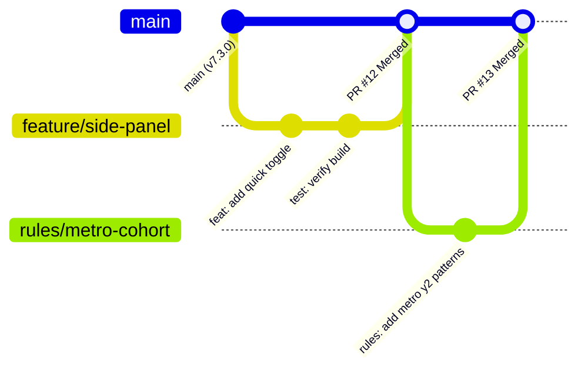

# Contributing to SLIIT Courseweb Cleaner

Thank you for your interest in contributing to SLIIT Courseweb Cleaner. This project is a community-driven, student-developed open-source utility licensed under the MIT License. Contributions from all SLIIT campuses (Malabe, Metro, Kandy, Kurunegala, Matara, Jaffna) and partner academic programs (Curtin, Deakin) are welcomed and encouraged.

This guide outlines our architecture, engineering standards, testing routines, and pull request procedures to ensure seamless cross-browser reliability.

<p align="center">
  <a href="README.md">README</a> &bull;
  <a href="CONTRIBUTING.md">Contributing</a> &bull;
  <a href="CODE_OF_CONDUCT.md">Code of Conduct</a> &bull;
  <a href="SECURITY.md">Security Policy</a> &bull;
  <a href="SUPPORT.md">Support</a> &bull;
  <a href="LICENSE">License</a>
</p>

---

## Core Engineering Principles

Every contribution must preserve these non-negotiable architectural tenets:

1. **Client-Side Privacy and Zero Telemetry**:
   The extension operates strictly within the client browser. We never collect, transmit, or persist student registration IDs, submission files, cookies, or browsing histories. Outbound network communication is limited exclusively to an anonymous read-only fetch for updated community heuristics (`rules.json`).

2. **Non-Destructive DOM Filtering**:
   Never permanently remove (`remove()`) DOM nodes from the document tree. Use style-based CSS suppression (`display: none`) or Ghost Mode muting (`opacity: 0.25`). Filtering must always honor the Double-Lock Defense check, guaranteeing that unconfigured users never experience content loss.

3. **Notice and Critical Element Protection**:
   Never hide elements matching protected keywords (`notice`, `rescheduled`, `announcement`, `general`, `exam`) or functional Moodle controls (`.groupselector`, `.singleselect`, breadcrumbs, navigation drawers, search inputs, submission upload forms).

4. **Strict CSP and Security Invariants**:
   SLIIT Courseweb enforces Content Security Policies. Do not introduce `eval()`, `new Function()`, inline `<script>` tags, or remote code execution. All dependencies must be statically bundled and local.

---

## Contribution Matrix

| Functional Area | Scope and Responsibilities | Primary Files |
| :--- | :--- | :--- |
| **Community Rules** | Add new campus center aliases, batch formats, or protected keywords. | `rules.json` |
| **Core Filtering Engine** | Refine regex parsing, section isolation, or Double-Lock algorithms. | `src/shared-core.js` |
| **Extension Runtime** | Service worker alarms, MV3 background lifecycle, storage sync. | `src/extension-main.js`, `extension/service-worker.js` |
| **Userscript Runtime** | Tampermonkey / Violentmonkey sandbox compatibility, GM_* APIs. | `src/userscript-main.js` |
| **UI & Ergonomics** | Slide-panel drawer, popup views, responsive layout, keyboard navigation. | `src/shared-styles.css`, `src/popup.*` |
| **Dark Theme Tuning** | CSS contrast optimization for Moodle tables, notices, and buttons. | `src/shared-styles.css`, `src/darkreader.js` |
| **Documentation & QA** | Developer specifications, installation guides, store listings, Wiki. | `README.md`, `wiki/`, `site/` |

---

## Development Environment Setup

### Prerequisites

- **Node.js**: Version 18.0.0 or higher.
- **npm**: Version 9.0.0 or higher.
- **Git**: Modern Git client.
- **POSIX Shell**: Bash or Zsh to execute `./build.sh` (Linux, macOS, WSL on Windows).
- **Target Browser**: Google Chrome, Microsoft Edge, Brave, or Mozilla Firefox.

### 1. Clone the Repository

```bash
git clone https://github.com/dulithdivisekara/sliit-courseweb-cleaner.git
cd sliit-courseweb-cleaner
```

### 2. Verify Node Environment

The project requires zero third-party runtime production dependencies. Verify the syntax checker and test suite:

```bash
npm test
```

### 3. Load the Unpacked Extension

#### Chromium (Google Chrome, Microsoft Edge, Brave, Opera)
1. Open `chrome://extensions` (or `edge://extensions`).
2. Enable **Developer mode** via the top-right toggle.
3. Click **Load unpacked** and select the `extension/` directory.
4. Navigate to [SLIIT Courseweb](https://courseweb.sliit.lk/) to inspect your live changes.

#### Mozilla Firefox
1. Open Firefox and navigate to `about:debugging#/runtime/this-firefox`.
2. Click **Load Temporary Add-on...**.
3. Select `extension/manifest.firefox.json` from the repository.
4. Open [SLIIT Courseweb](https://courseweb.sliit.lk/) to verify behavior.

#### Userscript (Tampermonkey / Violentmonkey)
1. In your userscript manager settings, enable **Developer Mode** and allow local file access.
2. Install the compiled file from `dist/sliit-courseweb-cleaner.user.js`.
3. Consult [USERSCRIPT_INSTALL.md](USERSCRIPT_INSTALL.md) for full configuration steps.

---

## Architecture and Monorepo Layout

The repository uses a single canonical source tree compiled into three distribution formats:

```text
.
├── src/                                  # Canonical source code (Edit here)
│   ├── shared-core.js                    # Reusable filtering engine and regex rules
│   ├── shared-styles.css                 # Content script styles and side-panel drawer
│   ├── extension-main.js                 # WebExtension content script entry point
│   ├── userscript-main.js                # Userscript wrapper and initialization
│   ├── popup.html / popup.js / popup.css # Extension action popup markup and logic
│   └── darkreader.js                     # Standalone Dark Reader engine
├── extension/                            # Staging directory for browser extensions
│   ├── manifest.json                     # Chromium Manifest V3 definition
│   ├── manifest.firefox.json             # Firefox WebExtension definition
│   ├── service-worker.js                 # Background worker with 24h sync alarm
│   └── [compiled assets]                 # Mirrored from src/ during build
├── dist/                                 # Production packages generated by build.sh
│   ├── sliit-courseweb-cleaner-extension.zip # Chrome & Edge deployment package
│   ├── sliit-courseweb-cleaner-firefox.zip   # Firefox AMO deployment package
│   └── sliit-courseweb-cleaner.user.js       # Assembled Tampermonkey userscript
├── rules.json                            # Remote filtering heuristics and pattern dictionary
├── build.sh                              # Multi-target build and packaging script
├── package.json                          # Scripts and syntax checking configuration
├── SECURITY.md                           # Vulnerability disclosure and threat model
├── CODE_OF_CONDUCT.md                    # Community standards and guidelines
└── SUPPORT.md                            # Troubleshooting playbook and support channels
```

> [!IMPORTANT]
> Always edit files inside the `src/` directory. Files in `extension/` (such as `styles.css` and `shared-core.js`) and `dist/` are generated build targets that are overwritten on every build.

---

## Build Pipeline

Execute the multi-target packaging pipeline after making modifications in `src/`:

```bash
chmod +x build.sh
./build.sh
```

### Build Sequence
1. **Userscript Assembly**: Concatenates `src/userscript-main.js` with `src/shared-core.js` into `dist/sliit-courseweb-cleaner.user.js`.
2. **Extension Workspace Sync**: Copies canonical files from `src/` into the `extension/` staging workspace.
3. **Chromium Packaging**: Creates `dist/sliit-courseweb-cleaner-extension.zip` containing Manifest V3 configurations.
4. **Firefox AMO Packaging**: Stages Firefox manifests and builds `dist/sliit-courseweb-cleaner-firefox.zip`.

---

## Contributing to Filtering Rules

If your faculty or campus introduces new course naming conventions, update `rules.json` without touching core JavaScript logic:

### Schema Overview

```json
{
  "version": 2,
  "lastUpdated": "2026-11-03",
  "campuses": [
    "malabe",
    "kandy",
    "kurunegala",
    "metro",
    "matara",
    "jaffna",
    "deakin",
    "curtin"
  ],
  "batchPatterns": {
    "weekday": ["wd", "weekday"],
    "weekend": ["we", "weekend"]
  },
  "ignoreKeywords": [
    "notice",
    "rescheduled",
    "announcement",
    "general"
  ],
  "malabeBlockRegexes": [
    "\\\\bbatch\\\\s*\\\\d+\\\\b",
    "\\\\by2s1\\\\.b\\\\d+",
    "\\\\by2s1\\\\.lab_\\\\w+"
  ]
}
```

### Heuristic Rule Standards
1. **Lowercase Keys**: Keywords in `campuses` and `batchPatterns` must be lowercase. Text is normalized before matching.
2. **Double-Escaped Regex**: Regex backslashes must be double-escaped (e.g., `\\\\b` instead of `\\b`) to guarantee valid JSON serialization.
3. **Avoid Overly Broad Matchers**: Do not use generic substrings (e.g., `it`, `se`, `cs`) that might trigger false-positive matches on legitimate course titles.
4. **DevTools Pre-Verification**: Test patterns in the browser console against real course titles before submitting:
   ```javascript
   const regex = new RegExp("\\bbatch\\s*\\d+\\b", "i");
   console.log(regex.test("Lab 02 Submission - Malabe Weekday Batch 03")); // true
   ```

---

## Coding Standards

### JavaScript
- Modern ES6+ syntax with vanilla implementations (no external frameworks).
- Maintain documentation integrity and preserve functional docstrings.
- Encapsulate internal helpers; do not pollute global window namespaces.
- Ensure DOM observer callbacks avoid synchronous reflows or layout thrashing.

### CSS and Styling
- Prefix all custom selectors (`sf-side-panel`, `sf-config-trigger`, `sf-drawer`, `sf-stat`) to avoid conflicts with Moodle themes.
- Enforce WCAG AA contrast standards (minimum 4.5:1 for standard text).
- Responsive: The slide-in configuration panel must adapt seamlessly to viewports under `480px`.

---

## Git Workflow and Branching



### Branch Naming Conventions

Create a topic branch from `main`:
```bash
git checkout -b <type>/<short-description>
```

- `feat/keyboard-navigation`
- `fix/metro-batch-regex`
- `rules/kandy-semester-patterns`
- `style/notice-banner-contrast`
- `docs/troubleshooting-guide`

### Conventional Commits

Commit messages must follow the Conventional Commits specification:

| Type | Intent | Example |
| :--- | :--- | :--- |
| `feat` | New feature or user-facing enhancement | `feat: implement peek mode for hidden items` |
| `fix` | Bug fix or false-positive regex correction | `fix: prevent hiding announcements with date tokens` |
| `rules` | Heuristics modifications in `rules.json` | `rules: add northern campus alias and semester patterns` |
| `style` | Visual tweaks, theme contrast, CSS formatting | `style: improve notice container contrast in dark mode` |
| `refactor` | Code refactoring without behavior change | `refactor: optimize section-scoped heuristic evaluation` |
| `test` | Automated checks, syntax validation | `test: add JSON validation check for rules schema` |
| `docs` | Documentation and specification updates | `docs: expand contributing guide with architecture details` |
| `chore` | Maintenance tasks or build adjustments | `chore: clean temporary staging paths in build script` |

---

## Pull Request Submission Checklist

Before submitting a Pull Request, verify:

- [ ] Edits were made in `src/` (not directly in `extension/` or `dist/`).
- [ ] `./build.sh` was executed to rebuild extension files and distribution bundles.
- [ ] `npm test` passed without errors.
- [ ] Manually tested on [SLIIT Courseweb](https://courseweb.sliit.lk/) in at least one browser.
- [ ] No personally identifiable student information (names, IDs, tokens) is present in commits or screenshots.
- [ ] Branch is rebased onto the latest `main` branch.

### Submitting Your PR

1. Push your branch to your GitHub fork:
   ```bash
   git push origin <type>/<short-description>
   ```
2. Open a Pull Request against `dulithdivisekara/sliit-courseweb-cleaner` on branch `main`.
3. Provide a concise summary of the problem solved, reference linked issues (e.g., `Closes #5`), and attach screenshots if UI changes were introduced.

---

## Community Governance and Safety

- **Code of Conduct**: All contributors are required to abide by our [Code of Conduct](CODE_OF_CONDUCT.md) (Contributor Covenant v2.1).
- **Security Vulnerabilities**: Disclose vulnerabilities responsibly by following our [Security Policy](SECURITY.md). Do not file public issues for security exploits.
- **Support & Troubleshooting**: Need help getting started? Check our [Support Guide](SUPPORT.md) or join our community channels.

---

## Core Contributors

Sincere appreciation to the students and developers who build, maintain, and support SLIIT Courseweb Cleaner:

- **Dulith Divisekara** ([@dulithdivisekara](https://github.com/dulithdivisekara)) - Creator and Lead Maintainer.
- **Kavindu Udhara** ([@kavinduUdhara](https://github.com/kavinduUdhara)) - UI/UX improvements, anti-flash preloader, side-panel drawer, and notice contrast enhancements (#3).
- **Kesaru Hasun** ([@kesaruhasun](https://github.com/kesaruhasun)) - Author of the SLIIT Courseweb Model Context Protocol (MCP) server.
