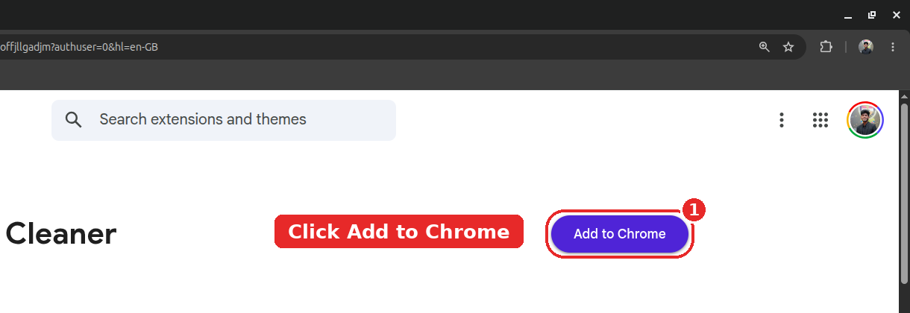
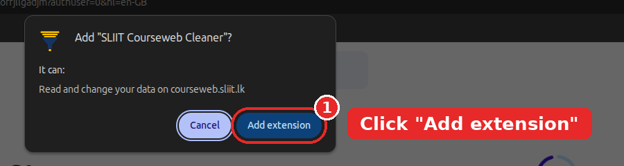
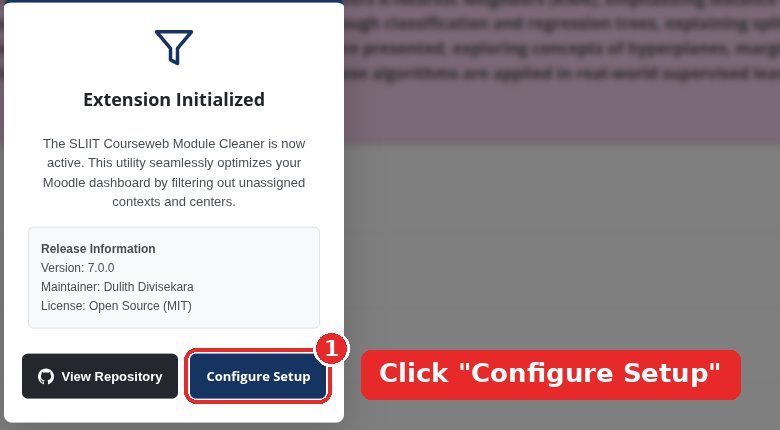
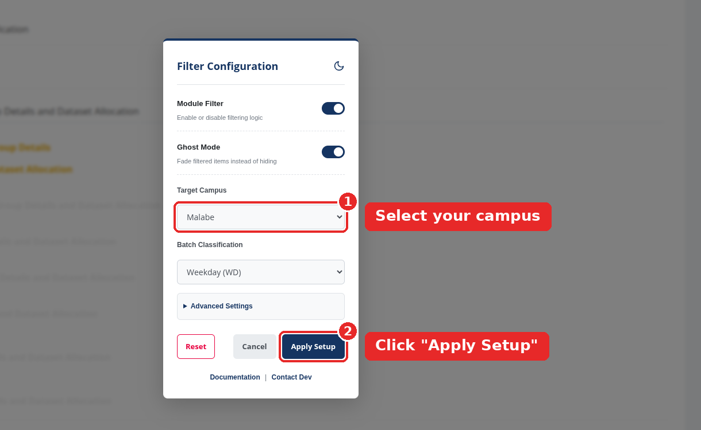
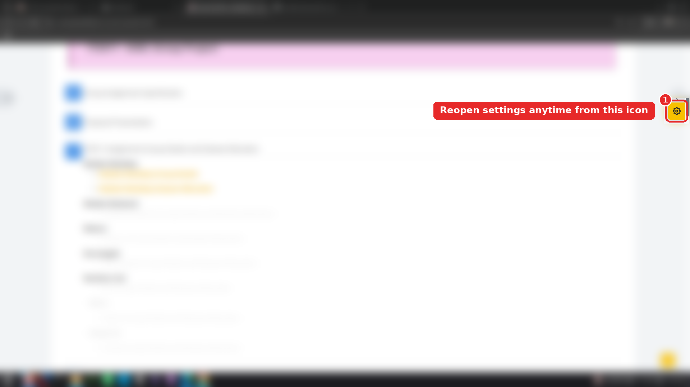

# SLIIT Courseweb Module Cleaner

  
  
  
  
  

A professional, context-aware browser extension designed to optimize the SLIIT Moodle (Courseweb) interface. It introduces a site-wide high-contrast **Dark Theme**, quick-access **Toolbar Action Popup**, and automatically filters out irrelevant modules, assignments, and announcements meant for unassigned campuses or batches.

🌐 **Official Website & Docs:** [sliit-courseweb-cleaner-web.pages.dev](https://sliit-courseweb-cleaner-web.pages.dev/)

---

## Download & Install

Install the official extension directly from your browser's web store:

* **Google Chrome / Brave:** [Download on Chrome Web Store](https://chromewebstore.google.com/detail/sliit-courseweb-cleaner/lnoadlfhebmkhmbfmehdgoffjllgadjm?authuser=0&hl=en-GB)
* **Microsoft Edge:** [Download on Edge Add-ons](https://microsoftedge.microsoft.com/addons/detail/sliit-courseweb-cleaner/gmlodfhgiopjgamoijjffcmgfenkkkhe)
* **Mozilla Firefox:** [Download on Firefox Add-ons](https://addons.mozilla.org/en-US/firefox/addon/sliit-courseweb-cleaner/)

> **Advanced Users:** Prefer Tampermonkey? Check our [Userscript Installation Guide](USERSCRIPT_INSTALL.md).

---

## Quick Start Guide

### Step 1: Add to Browser
First, navigate to your respective web store and click the **Add to Chrome** (or **Get**) button.

  

 

Then, confirm the installation by clicking **Add extension** on the browser permission popup.

  

 

### Step 2: Initialize
Open any module page on [SLIIT Courseweb](https://courseweb.sliit.lk/). The extension will greet you with a welcome screen. Click **Configure Setup** to proceed.

  

 

### Step 3: Configure Your Preferences
Select your campus, batch type, and apply any advanced custom keywords. Click **Apply Setup** to lock in your preferences and clean your dashboard.

  

 

### Step 4: Re-access Settings & Support
You can toggle Dark Mode and update your profile anytime using the new **Toolbar Action Popup** or the floating yellow settings icon anchored on course pages.

  

 

---

## Key Features

* **Dynamic Dark Theme:** Integrated with the open-source Dark Reader engine to provide an eye-friendly, high-contrast dark theme across all Courseweb pages (dashboard `/my/`, course overview `/my/courses.php`, module views, and activities).
* **Modern Toolbar Action Popup:** Quick-access popup window right in your browser toolbar with rounded corners, live profile syncing, "Apply Setup" confirmation, and Dark Mode toggle.
* **Campus & Batch Filtering:** Clean view showing only your selected campus (Malabe, Metro, Kandy, Kurunegala, Matara, Jaffna) and batch (Weekday / Weekend).
* **Partner Program Isolation:** Automatically filters out external international degree streams (such as Deakin or Curtin) from local batch dashboards.
* **Course & Selector Protection:** Filtering is strictly scoped to course module views, preventing any interference with dashboard blocks, course selectors, category dropdowns, or Moodle interactive forms.
* **Custom Keywords:** Full control with custom comma-separated Whitelists and Blacklists.
* **Cloud-Synced Rules:** The extension periodically fetches community-sourced filtering rules in the background (`rules.json`).
* **Double-Lock Defense:** Prevents aggressive filtering before your initial user setup is complete.
* **Notice Protector:** Ensures critical alerts, rescheduled labs, and general shared materials remain strictly visible regardless of filter settings.

---

## Regional Center Scope & Contributing

> [!NOTE]
> This extension is primarily developed, tailored, and tested against **SLIIT Malabe Campus (Weekday and Weekend batches)** curriculum patterns and naming structures.

While other centers (**Metro**, **Kandy**, **Kurunegala**, **Matara**, and **Jaffna**) are supported, module naming conventions at regional centers can occasionally vary across faculties.

If you encounter any issues, misidentified links, or unhidden foreign items for your specific center, community contributions are warmly welcomed! Please feel free to open a **Pull Request** with the updated regex patterns in [`rules.json`](rules.json) or [`src/shared-core.js`](src/shared-core.js) — we will gladly review and merge it. Alternatively, open an issue on our [GitHub Issues](https://github.com/dulithdivisekara/sliit-courseweb-cleaner/issues) tracker.

---

## Related Projects & Ecosystem

* **[SLIIT Courseweb MCP Server](https://github.com/kesaruhasun/mcp-sliit-courseweb)** by [@kesaruhasun](https://github.com/kesaruhasun): A Model Context Protocol (MCP) server for SLIIT Courseweb that enables AI assistants (such as Claude, Cursor, and custom agentic workflows) to interact with course materials, notices, and module structures directly.

---

## License
This project is licensed under the MIT License. See the [`LICENSE`](LICENSE) file for details. Developed and maintained by Dulith Divisekara.
