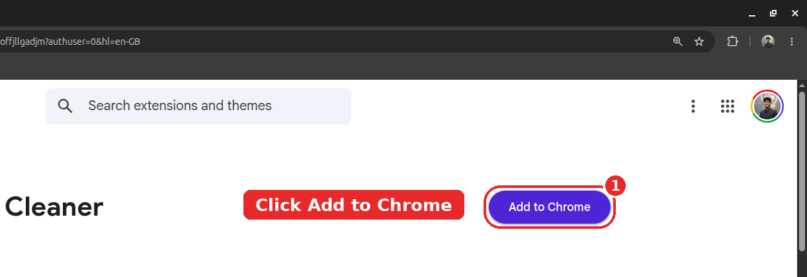
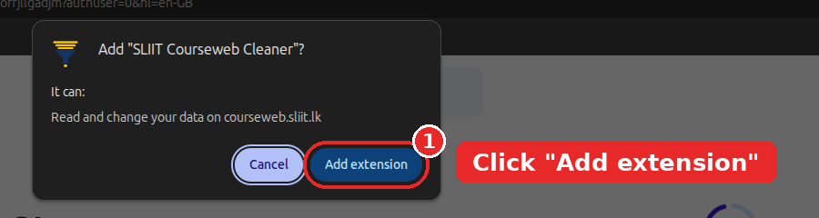
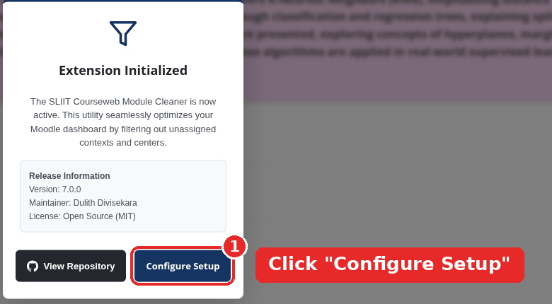
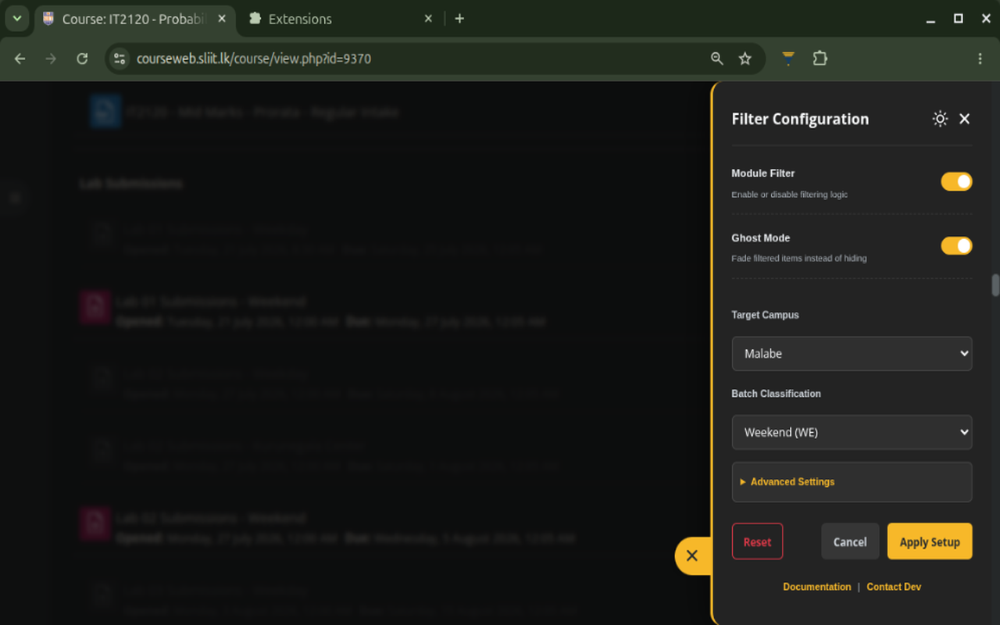
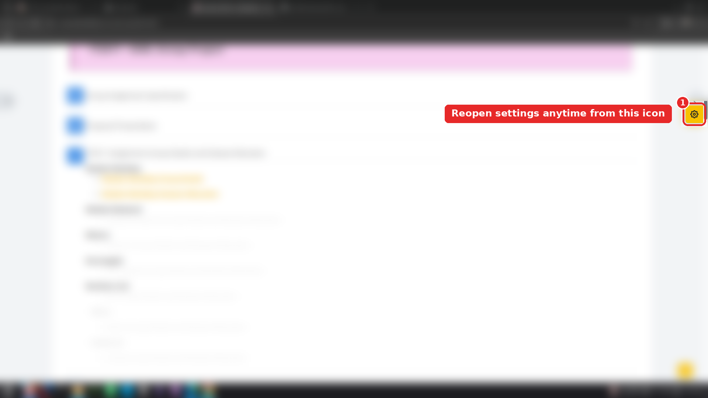
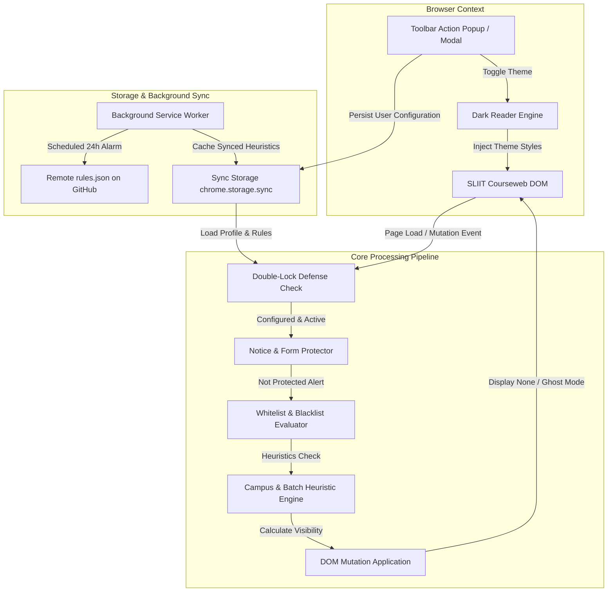

<p align="center">
  <a href="https://sliit-courseweb-cleaner-web.pages.dev/" target="_blank" rel="noopener noreferrer">
    
  </a>
</p>

<h1 align="center">SLIIT Courseweb Module Cleaner</h1>

<p align="center">
  Context-aware browser extension and userscript engineered to optimize the SLIIT Moodle interface through intelligent campus-batch filtering, partner program isolation, and native dark theme integration.
</p>

<p align="center">
  <a href="https://chromewebstore.google.com/detail/sliit-courseweb-cleaner/lnoadlfhebmkhmbfmehdgoffjllgadjm"></a>
  <a href="https://microsoftedge.microsoft.com/addons/detail/sliit-courseweb-cleaner/gmlodfhgiopjgamoijjffcmgfenkkkhe"></a>
  <a href="https://addons.mozilla.org/en-US/firefox/addon/sliit-courseweb-cleaner/"></a>
  <a href="LICENSE"></a>
</p>

<p align="center">
  <a href="#overview">Overview</a> &bull;
  <a href="#download--install">Download</a> &bull;
  <a href="#quick-start-guide">Quick Start</a> &bull;
  <a href="#architecture">Architecture</a> &bull;
  <a href="#project-structure">Structure</a> &bull;
  <a href="#installation">Installation</a> &bull;
  <a href="#usage">Usage</a> &bull;
  <a href="#session-logging--inspection">Logging</a> &bull;
  <a href="#verification-tests">Testing</a> &bull;
  <a href="#security--privacy">Security</a> &bull;
  <a href="https://github.com/dulithdivisekara/sliit-courseweb-cleaner/wiki">Wiki</a> &bull;
  <a href="#license">License</a>
</p>

---

## Overview

SLIIT Courseweb Cleaner addresses information density and visual clutter across the SLIIT Moodle learning management system. Course pages routinely aggregate assignments, lecture materials, lab schedules, announcements, and quizzes intended for disparate physical centers (Malabe, Metro, Kandy, Kurunegala, Matara, Jaffna), independent cohort schedules (Weekday and Weekend tracks), and international partner degree programs (such as Curtin University and Deakin University). Without automated filtering, students must manually discern relevant coursework from hundreds of irrelevant listings.

Operating directly within the browser document model, the extension evaluates activity blocks, section titles, and nested course labels against the student's designated profile and background-synchronized community heuristics (`rules.json`). Non-matching items are either hidden or gracefully dimmed in Ghost Mode.

To prevent interface fatigue, the extension incorporates a customized Dark Reader engine configured specifically for Moodle UI tokens, alongside a zero-latency anti-flash preloader that eradicates white flashes during page transitions. Settings are managed through a modern toolbar action popup or an ergonomic, slide-in side panel drawer anchored above the Moodle page-top button, enabling rapid profile switching without disrupting active academic sessions.

---

## Download & Install

Official 1-click store links for supported desktop web browsers:

<p align="center">
  <a href="https://chromewebstore.google.com/detail/sliit-courseweb-cleaner/lnoadlfhebmkhmbfmehdgoffjllgadjm" target="_blank" rel="noopener noreferrer">
    
  </a>
  &nbsp;&nbsp;&nbsp;&nbsp;
  <a href="https://microsoftedge.microsoft.com/addons/detail/sliit-courseweb-cleaner/gmlodfhgiopjgamoijjffcmgfenkkkhe" target="_blank" rel="noopener noreferrer">
    
  </a>
  &nbsp;&nbsp;&nbsp;&nbsp;
  <a href="https://addons.mozilla.org/en-US/firefox/addon/sliit-courseweb-cleaner/" target="_blank" rel="noopener noreferrer">
    
  </a>
</p>

| Browser | Supported Platforms | Official Store Listing | Direct Action |
| :--- | :--- | :--- | :--- |
| **Google Chrome** | Chrome, Brave, Opera, Vivaldi | Chrome Web Store | [Add to Chrome](https://chromewebstore.google.com/detail/sliit-courseweb-cleaner/lnoadlfhebmkhmbfmehdgoffjllgadjm) |
| **Microsoft Edge** | Edge, Chromium on Windows / macOS / Linux | Microsoft Edge Add-ons | [Get for Edge](https://microsoftedge.microsoft.com/addons/detail/sliit-courseweb-cleaner/gmlodfhgiopjgamoijjffcmgfenkkkhe) |
| **Mozilla Firefox** | Firefox, Waterfox, LibreWolf, Floorp | Firefox Browser Add-ons (AMO) | [Add to Firefox](https://addons.mozilla.org/en-US/firefox/addon/sliit-courseweb-cleaner/) |

> [!TIP]
> Prefer using Tampermonkey or Violentmonkey? You can install the compiled script directly via our [Userscript Installation Guide](USERSCRIPT_INSTALL.md).

---

## Quick Start Guide

A visual step-by-step guide to installing and configuring the extension in Google Chrome, Microsoft Edge, and Brave.

### 1. Add to Browser
Navigate to the [Chrome Web Store](https://chromewebstore.google.com/detail/sliit-courseweb-cleaner/lnoadlfhebmkhmbfmehdgoffjllgadjm) (or [Microsoft Edge Add-ons](https://microsoftedge.microsoft.com/addons/detail/sliit-courseweb-cleaner/gmlodfhgiopjgamoijjffcmgfenkkkhe)) and click the **Add to Chrome** (or **Get**) button.

<p align="center">
  
</p>

When prompted by the browser permissions dialog, click **Add extension** to complete the installation.

<p align="center">
  
</p>

### 2. Initialize on Courseweb
Navigate to any course module page on [SLIIT Courseweb](https://courseweb.sliit.lk/). The setup dialog will display automatically on your first visit. Click **Configure Setup** to begin.

<p align="center">
  
</p>

### 3. Configure Your Preferences
Select your campus center (Malabe, Metro, Kandy, Kurunegala, Matara, Jaffna / Northern Uni, Deakin, or Curtin) and your batch schedule (Weekday or Weekend) inside the slide-in side panel drawer. You can also configure optional group or batch identifiers (e.g., `2`, `01.02`, or `Y2.S1.WD.IT.01.02`), custom whitelist/blacklist terms, Ghost Mode, or the **Hide Submissions** toggle. All changes apply instantaneously to the active view without requiring a page reload.

<p align="center">
  
</p>

### 4. Adjust Settings Anytime
You can update your campus profile, toggle Ghost Mode, or switch Dark Theme on and off anytime using the browser **Toolbar Action Popup** or the floating yellow settings trigger anchored at the bottom-right of course pages. Clicking the trigger smoothly slides out the configuration side panel.

<p align="center">
  
</p>

---

## Architecture

The system compiles from a shared modular core into three distinct deployment targets: Chromium Manifest V3, Mozilla Firefox WebExtensions, and a standalone userscript bundle.

| Feature | Chromium Extension (MV3) | Firefox Extension | Userscript Engine |
| :--- | :--- | :--- | :--- |
| **Target Browsers** | Chrome, Edge, Brave, Opera | Mozilla Firefox | Any browser with Tampermonkey / Violentmonkey |
| **Runtime Model** | Service Worker (`background.service_worker`) | Background Scripts / Gecko MV3 | Userscript Sandbox (`GM_*` API) |
| **State Persistence** | `chrome.storage.sync` with local fallback | `browser.storage.sync` / `chrome.storage.sync` | `GM_setValue` / `GM_getValue` |
| **Rule Synchronization** | Background `chrome.alarms` (24-hour cycle) | Background periodic fetch | Manual / automatic script update via `@updateURL` |
| **Dark Theme Strategy** | Bundled local `darkreader.js` | Bundled local `darkreader.js` | CDN require (`@require darkreader.min.js`) |
| **UI Components** | Toolbar Popup + Slide-Panel Drawer | Toolbar Popup + Slide-Panel Drawer | Slide-Panel Drawer |
| **Distribution Channel** | Chrome Web Store / Edge Add-ons | Mozilla Firefox Add-ons (AMO) | GitHub Raw JS Distribution |



---

## Project Structure

```
.
├── assets/                  # Brand marks, high-resolution logos, and documentation assets
│   ├── logo.png             # Official 512x512 transparent brand mark
│   ├── badge-chrome.png     # Official Chrome Web Store store badge
│   ├── badge-edge.png       # Official Microsoft Edge Add-ons store badge
│   ├── badge-firefox.png    # Official Firefox Add-ons store badge
│   ├── store-screenshots/   # 1280x800 verified store listing screenshots
│   └── *.png                # Setup workflow captures and store previews
├── dist/                    # Compiled distribution artifacts
│   ├── sliit-courseweb-cleaner-extension.zip # Chrome & Edge deployment package
│   ├── sliit-courseweb-cleaner-firefox.zip   # Firefox AMO deployment package
│   └── sliit-courseweb-cleaner.user.js       # Assembled Tampermonkey userscript
├── extension/               # Browser extension runtime workspace
│   ├── icons/               # Extension icons (16px, 48px, 128px)
│   ├── manifest.json        # Chromium Manifest V3 specification
│   ├── manifest.firefox.json# Firefox WebExtension specification
│   ├── popup.html           # Toolbar popup markup
│   ├── popup.js             # Toolbar popup controller
│   ├── popup.css            # Toolbar popup style definitions
│   ├── service-worker.js    # Background service worker with 24-hour sync alarm
│   ├── shared-core.js       # Compiled shared filtering heuristics
│   └── styles.css           # Content script and modal styling
├── site/                    # Official landing page hosted on Cloudflare Pages
│   ├── index.html           # Marketing and installation portal
│   └── privacy-policy.html  # Public compliance documentation
├── src/                     # Canonical engineering source code
│   ├── darkreader.js        # Bundled Dark Reader engine
│   ├── extension-main.js    # Browser extension content script entrypoint
│   ├── icon.svg             # Source vector brand asset
│   ├── popup.*              # Action popup source files
│   ├── shared-core.js       # Reusable campus, batch, and protection heuristics
│   ├── shared-styles.css    # Reusable modal and floating action styles
│   └── userscript-main.js   # Tampermonkey userscript wrapper and entrypoint
├── wiki/                    # Multi-page GitHub Wiki technical documentation suite
├── build.sh                 # Multi-target assembly and packaging pipeline
├── package.json             # NPM metadata, build commands, and syntax validation targets
└── rules.json               # Community regex patterns, campus aliases, and ignore keywords
```

---

## Installation

### Official Web Stores

Install verified builds directly from official browser repositories:

- **Google Chrome / Brave / Opera:** [Chrome Web Store](https://chromewebstore.google.com/detail/sliit-courseweb-cleaner/lnoadlfhebmkhmbfmehdgoffjllgadjm)
- **Microsoft Edge:** [Microsoft Edge Add-ons](https://microsoftedge.microsoft.com/addons/detail/sliit-courseweb-cleaner/gmlodfhgiopjgamoijjffcmgfenkkkhe)
- **Mozilla Firefox:** [Firefox Add-ons (AMO)](https://addons.mozilla.org/en-US/firefox/addon/sliit-courseweb-cleaner/)

### Manual Developer Installation

To run an unpacked build directly from source:

1. Clone the repository:
   ```bash
   git clone https://github.com/dulithdivisekara/sliit-courseweb-cleaner.git
   cd sliit-courseweb-cleaner
   ```
2. Build distribution archives:
   ```bash
   chmod +x build.sh
   ./build.sh
   ```
3. Load unpacked extension:
   - **Chromium (Chrome / Edge / Brave):** Navigate to `chrome://extensions`, enable **Developer mode**, click **Load unpacked**, and select the `extension/` directory.
   - **Firefox:** Navigate to `about:debugging#/runtime/this-firefox`, click **Load Temporary Add-on**, and select `extension/manifest.firefox.json`.

### Userscript Installation

For environments utilizing Tampermonkey or Violentmonkey:

1. Ensure your userscript manager has script execution permissions enabled.
2. Install the compiled userscript directly:
   **[Install sliit-courseweb-cleaner.user.js](https://github.com/dulithdivisekara/sliit-courseweb-cleaner/raw/refs/heads/main/dist/sliit-courseweb-cleaner.user.js)**
3. Refer to [USERSCRIPT_INSTALL.md](USERSCRIPT_INSTALL.md) for full browser configuration guidance.

---

## Usage

### Primary Workflow

1. Navigate to any module page on [SLIIT Courseweb](https://courseweb.sliit.lk/).
2. On initial visit, the configuration dialog displays automatically.
3. Configure your academic profile:
   - **Campus:** Select your campus (Malabe, Metro, Kandy, Kurunegala, Matara, Jaffna / Northern Uni, Deakin, or Curtin).
   - **Batch Track:** Select Weekday or Weekend schedule.
   - **Group / Batch ID:** Enter your designated batch number or student group identifier (e.g., `2`, `01.02`, or `Y2.S1.WD.IT.01.02`).
   - **Ghost Mode:** Toggle between complete DOM suppression (`display: none`) and muted transparency (`opacity: 0.25`).
   - **Hide Submissions:** Temporarily hide assignment submission dropboxes while keeping assignment specification PDFs and marking rubrics visible.
4. Click **Apply Setup** (or toggle switches directly for instant live updates) to store preferences in synchronized browser storage.
5. Use the **Live Filter Status Banner** and **Peek Hidden** button inside the side panel to inspect the exact number of filtered items on the page at any time.

### Operational Features

| Component | Technical Behavior |
| :--- | :--- |
| **Double-Lock Defense** | Suppresses filtering routines until user setup is confirmed, preventing false-positive content removal during initial enrollment. |
| **Section-Scoped Filtering Engine** | Isolates sticky section context strictly within individual Moodle `.section` containers and protects core learning materials (Lecture Slides, Tutorials, Module Outlines, Marking Rubrics) from cross-section state bleed. |
| **Canonical Campus Alias Resolution** | Resolves regional center spelling variants and aliases (`Mathara`, `Kurunegale`, `Northern Uni`, `Nothern`, `NU Group`, `NU Dataset`, `Colombo`, `Kandy Center`) to the user's selected campus profile. |
| **Multi-Batch & Multi-Cohort Parser** | Parses compound batch declarations (`Batch 1 and 2`, `Batch 02 + Weekend Batch`, `Weekend Batch / Center Repeats & Northern Uni`) and universal academic group codes (`Y1`-`Y4`, `S1`-`S2`, `IT`/`SE`/`CS`/`DS`/`CSNE`/`ISE`/`IM`/`CY`/`BM`/`EN`). |
| **Hide Submissions Mode** | Provides a 1-click toggle in the Side Panel and Toolbar Popup to temporarily hide assignment submission dropboxes (`.modtype_assign`, Turnitin links) while preserving assignment specification PDFs and marking rubrics. |
| **Live Filter Counter & Peek Mode** | Displays a real-time filtered item badge on the floating trigger and a live status bar in the Side Panel with a **Peek Hidden** toggle to temporarily reveal hidden items with a dashed gold outline. |
| **Notice Protector** | Scans activity text against protected tokens (`notice`, `rescheduled`, `announcement`, `general`) while stripping Moodle 4.5 screen-reader (`Select activity Notice`) prefixes to prevent false positives. |
| **Notice Contrast Correction** | Applies high-contrast overrides (`#f7b924` background with `#141517` dark text) to yellow alert containers, guaranteeing full readability for red text and urgent announcements under dark theme. |
| **Anti-Flash Preloader** | Runs at `document_start` with synchronous `localStorage` theme state caching (`setAntiFlashTheme`), applying dark canvas background at 0ms before DOM rendering to eliminate white flashes on navigation. |
| **Side-Panel Drawer UI** | Replaces static modals with a smooth right-aligned slide-out drawer (`sf-side-panel`) with backdrop blur, keyboard dismissal, and responsive mobile adaptations. |
| **Ergonomic Trigger Anchor** | Anchors floating trigger to `bottom: 60px; right: 0` directly above Moodle's native back-to-top button, completely eliminating overlap with the collapsible block drawer. |
| **Ghost Mode (Peek Mode)** | Mutes unassigned cohort modules to `opacity: 0.25` instead of `display: none`, giving students a visual reference without interface clutter. |
| **Partner Program Isolation** | Context-aware regex rules automatically isolate international degree streams (Curtin University, Deakin University) from local batch dashboards. |
| **Header Logo Screen Blending** | Applies image filtering with `mix-blend-mode: screen` on the CourseWeb header crest, preventing dark mode background clash. |
| **Moodle UI Safeguard** | Explicitly excludes form elements, `.groupselector`, `.singleselect`, dropdowns, navigation drawers, and course category pickers from DOM filtering. |
| **CourseWeb CSP Compliance** | Suppresses DarkReader inline stylesheet proxy script injection to comply strictly with CourseWeb Content Security Policies. |
| **Automated Cloud Sync** | Synchronizes student preferences across authenticated browser profiles via `chrome.storage.sync` with automatic local fallback. |
| **Community Rule Updates** | Automatically schedules a 24-hour background alarm to fetch updated regex patterns (`rules.json`) from GitHub for newly introduced SLIIT course formats. |
| **Custom Filter Overrides** | Allows comma-separated keyword declarations for high-priority inclusion (Whitelist) or forced suppression (Blacklist). |
| **Dark Theme Engine** | Applies real-time CSS theme injection via Dark Reader with high-contrast rules preserving native brand buttons, form inputs, and modals. |

---

## Session Logging & Inspection

### Content Script Diagnostics

The extension prefixes operational log statements for straightforward filtering inside browser developer tools:

```javascript
// Filter console stream in browser DevTools
[Courseweb Cleaner]
```

### Background Service Worker Inspection

Chromium extensions execute background tasks in an isolated service worker context:

1. Open `chrome://extensions` and locate **SLIIT Courseweb Module Cleaner**.
2. Click **Inspect views: service worker** to open dedicated DevTools.
3. Inspect active scheduled alarms:
   ```javascript
   chrome.alarms.get('fetchRulesAlarm', (alarm) => console.log('Next scheduled rule sync:', alarm));
   ```
4. Query synchronized configuration state:
   ```javascript
   chrome.storage.sync.get(null, (config) => console.log('Active Configuration:', config));
   ```
5. Inspect cached community rules:
   ```javascript
   chrome.storage.local.get('remoteRules', (rules) => console.log('Cached Heuristics:', rules));
   ```

---

## Verification Tests

The repository includes Node.js syntax and integrity checks across all content scripts, workers, and distribution files without external runtime dependencies.

Execute the syntax verification suite:

```bash
npm test
```

Execute the compilation pipeline to regenerate all deployment targets:

```bash
npm run build
```

Verify that all target artifacts are present and non-empty:

```bash
ls -lh dist/
```

---

## Security & Privacy

- **Client-Side Processing:** All DOM parsing and filtering heuristics run strictly within the client browser sandbox. No student credentials, registration numbers, session cookies, or page contents are transmitted to external servers.
- **Minimal Host Permissions:** Extension permissions are restricted exclusively to `*://courseweb.sliit.lk/*` for DOM modification and GitHub raw endpoints for read-only `rules.json` updates.
- **Zero Third-Party Telemetry:** The extension contains no analytics trackers, advertising scripts, or data collectors.
- **Repository Credential Hygiene:** The repository `.gitignore` strictly excludes credentials, session logs (`*.log`), and local environment configurations (`.env*`, `cookies.json`).
- Review the complete [Privacy Policy](privacy-policy.html) and [Store Submission Metadata](CHROMEWEBSTORE.md).

---

## Ecosystem

- **[SLIIT Courseweb MCP Server](https://github.com/kesaruhasun/mcp-sliit-courseweb):** Model Context Protocol (MCP) server for SLIIT Courseweb by [@kesaruhasun](https://github.com/kesaruhasun), enabling LLMs and agentic workflows to interact directly with Courseweb notices and course structures.

---

## License

This project is licensed under the [MIT License](LICENSE).

<p align="center">
  <sub>Authored by <a href="https://dulith.me">Dulith Divisekara</a>. Independent student utility not affiliated with or endorsed by SLIIT.</sub>
</p>

