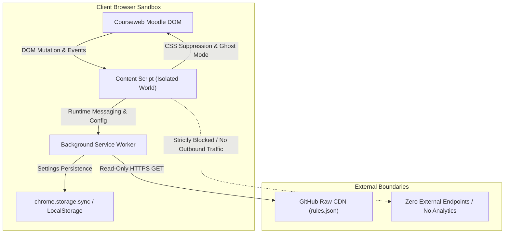

# Security Policy and Threat Model

The SLIIT Courseweb Cleaner project adheres to strict client-side sandboxing, data privacy, and vulnerability disclosure standards. Because this extension operates directly within students' authenticated academic environments, safeguarding user privacy and preventing malicious code execution are foundational requirements.

---

## Supported Versions

Security patches and bug fixes are prioritized for active versions distributed through official browser marketplaces and repository releases.

| Version | Status | Security Patches | Distribution Channels |
| :--- | :--- | :--- | :--- |
| **7.x** | Current Stable | Supported | Chrome Web Store, Microsoft Edge Add-ons, Firefox AMO, Userscript |
| **6.x** | Legacy | Deprecated | No further updates; upgrade to v7.x required |
| **< 6.0** | End of Life | Unsupported | No updates; obsolete manifest specifications |

---

## Vulnerability Disclosure Protocol

If you discover a security vulnerability, privilege escalation flaw, or potential privacy leak within the extension or userscript, please report it responsibly.

### How to Report

- **Email**: Send detailed disclosure reports to `contact@dulith.me`.
- **Direct Telegram**: Message `@dulithdivisekara` for critical escalations.
- **GitHub Security Advisory**: Submit a private report via the repository's **Security > Report a vulnerability** tab on GitHub.

> [!CAUTION]
> **Do not submit public GitHub issues or public comments for unpatched security vulnerabilities.** Public disclosure before a verified fix is released places student browser sessions at unnecessary risk.

### Disclosure Information Requested

To help us triage and resolve the issue expediently, please include:

1. **Description**: Clear description of the vulnerability, potential impact, and affected components (e.g., content script, popup, service worker, or userscript wrapper).
2. **Environment**: Browser name and version, extension version, and operating system.
3. **Reproduction Steps**: Step-by-step instructions or proof-of-concept (PoC) DOM snippet.
4. **Proposed Fix**: Any suggested mitigations or patches (if available).

### Response SLA and Timeline

- **Initial Acknowledgment**: Within 48 hours of receipt.
- **Triage & Risk Assessment**: Within 5 business days.
- **Patch Development & Verification**: Typically completed within 7 to 14 days, depending on severity.
- **Marketplace Deployment**: Expedited submission to Chrome Web Store, Microsoft Edge Add-ons, and Mozilla Firefox Add-ons.
- **Public Disclosure**: Coordinated after store approval and deployment across all platforms.

---

## Architectural Threat Model

SLIIT Courseweb Cleaner is intentionally designed with an immutable privacy-first architecture:



### 1. Zero Telemetry and Client-Side Exclusivity
- **No Third-Party Trackers**: The codebase contains zero analytics libraries, tracking pixels, crash telemetry, or third-party SDKs.
- **No Academic Data Collection**: The extension does not record, log, or exfiltrate student registration IDs, grades, course enrollments, submitted assignment files, or session cookies.
- **Local DOM Modification**: All filtering heuristics, regex evaluations, and Ghost Mode visibility toggles operate purely in browser memory within the client DOM tree.

### 2. Host Permissions and Network Isolation
- **Strict Host Scope**: Manifest declarations are strictly bounded to `*://courseweb.sliit.lk/*`. The extension cannot read, intercept, or modify traffic on any other domains.
- **Limited Remote Requests**: The only outbound network call initiated by the extension is a periodic read-only HTTPS request to fetch `rules.json` from the canonical GitHub repository:
  ```text
  https://raw.githubusercontent.com/dulithdivisekara/sliit-courseweb-cleaner/main/rules.json
  ```
- **Integrity Validation**: Fetched rules are strictly parsed as JSON; they are never executed as scripts, passed into `eval()`, or injected dynamically as executable code.

### 3. Content Security Policy (CSP) Compliance
- Moodle enforces strict `Content-Security-Policy` headers.
- The extension strictly adheres to these rules by disallowing `unsafe-eval`, inline scripts, and dynamic external script tags.
- The bundled Dark Reader engine is custom-configured to run without inline stylesheet proxy scripts, guaranteeing full CSP conformance without console policy violations.

### 4. Storage and Profile Confidentiality
- User preferences (campus selection, batch tracks, whitelist/blacklist terms) are stored exclusively in `chrome.storage.sync` with automatic fallback to `chrome.storage.local`.
- No sensitive credentials, auth cookies, or session secrets are ever stored in extension storage.
- Synced preferences are tied solely to the user's authenticated browser vendor account (Google/Microsoft account sync).

---

## Safe Harbor for Security Researchers

We consider security research conducted under this policy to be:
- **Authorized**: Conducted with the explicit permission of the project maintainers.
- **Protected**: We will not pursue legal action or report accounts for research conducted in good faith that complies with this disclosure policy.
- **Acknowledged**: Contributors who responsibly discover and report valid security issues will be formally credited in our release notes and contributor acknowledgments (with consent).

Thank you for helping keep the SLIIT student community secure.
