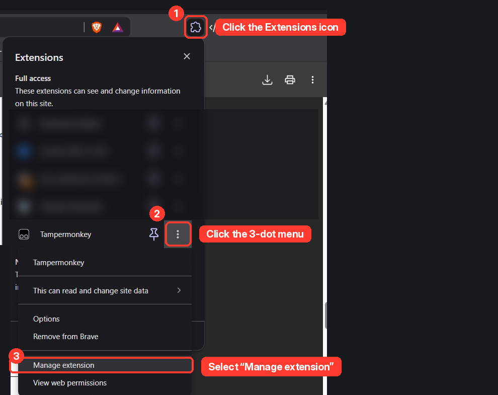
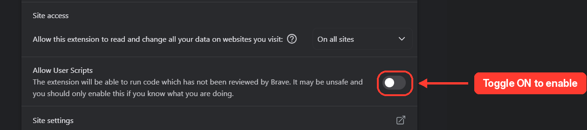
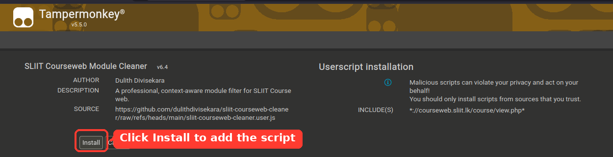

# Userscript Installation Guide

This guide outlines how power users and developers can run the compiled userscript distribution using Tampermonkey or Violentmonkey instead of the standalone browser extension.

  <a href="README.md">README</a> &bull;
  <a href="CONTRIBUTING.md">Contributing</a> &bull;
  <a href="CODE_OF_CONDUCT.md">Code of Conduct</a> &bull;
  <a href="SECURITY.md">Security Policy</a> &bull;
  <a href="SUPPORT.md">Support</a> &bull;
  <a href="LICENSE">License</a>

---

## 1. Install a Userscript Manager

Install a trusted userscript manager for your browser:

- **Google Chrome / Microsoft Edge / Brave:** [Tampermonkey on Chrome Web Store](https://chrome.google.com/webstore/detail/tampermonkey/dhdgffkkebhmkfjojejmpbldmpobfkfo)
- **Mozilla Firefox:** [Tampermonkey on Firefox Add-ons](https://addons.mozilla.org/en-US/firefox/addon/tampermonkey/)

### Chromium Security Note (Chrome, Edge, Brave)

Chromium extensions operating under Manifest V3 require users to grant script execution permissions:

1. Right-click the Tampermonkey icon in your browser toolbar and choose **Manage Extension**.

  

2. Scroll down on the extension configuration page and enable **Allow User Scripts** (or **Developer Mode**).

  

---

## 2. Install the Script

Once Tampermonkey is active and configured:

**[Click here to install sliit-courseweb-cleaner.user.js](https://github.com/dulithdivisekara/sliit-courseweb-cleaner/raw/refs/heads/main/dist/sliit-courseweb-cleaner.user.js)**

Tampermonkey will display the script review dialog. Click **Install** to confirm:

  

---

## 3. Initialize and Configure

1. Navigate to any course module page on [SLIIT Courseweb](https://courseweb.sliit.lk/).
2. The script initializes automatically upon DOM load.
3. Click the floating yellow settings trigger anchored at the bottom-right of your screen to slide out the configuration drawer.
4. Select your campus and batch tracks, and click **Apply Setup**.
