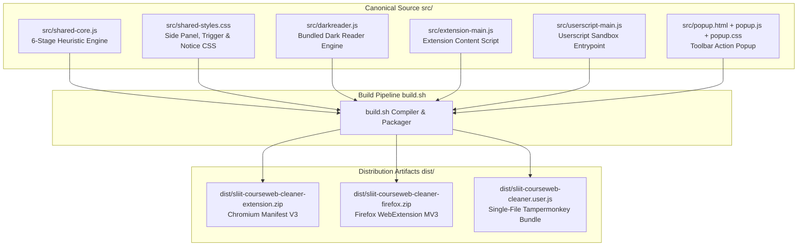
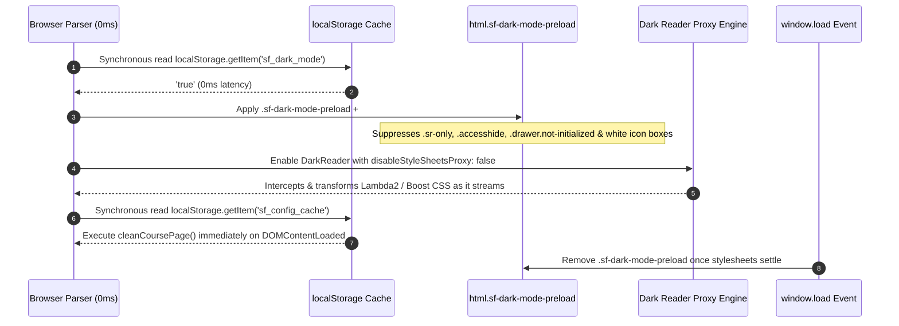
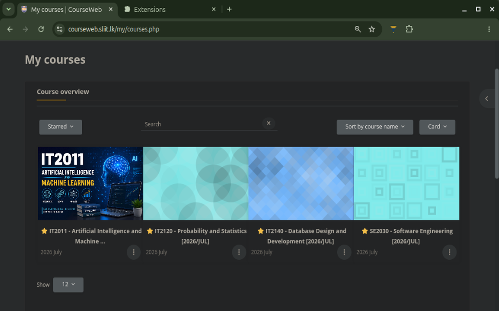
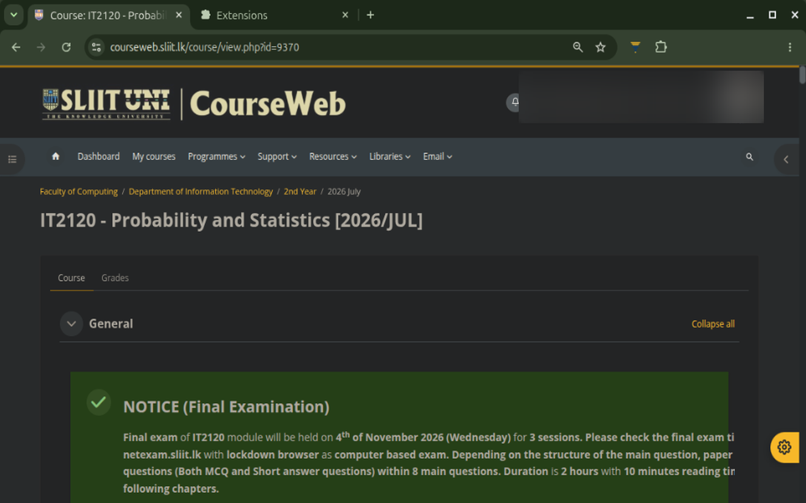

Architectural reference for the multi-target compilation pipeline, the `0ms` zero-flash Dark Theme preloader, Moodle Lambda2/Boost skeleton suppression, and background storage synchronization.

---

## Multi-Target Compilation Architecture

The project maintains a single canonical codebase in `src/` and compiles into three self-contained distribution targets via `build.sh`:

### Runtime Target Comparison

| Architectural Layer | Chromium Extension (`manifest.json`) | Firefox Extension (`manifest.firefox.json`) | Userscript (`sliit-courseweb-cleaner.user.js`) |
| :--- | :--- | :--- | :--- |
| **Execution Injection** | `content_scripts` at `document_start` | `content_scripts` at `document_start` | `@run-at document-start` |
| **Background Worker** | `service-worker.js` (`chrome.alarms`) | Background script with `browser_specific_settings.gecko` | Self-contained (`GM_*` storage APIs) |
| **Zero-Latency Cache** | `localStorage` (`sf_dark_mode`, `sf_config_cache`) | `localStorage` (`sf_dark_mode`, `sf_config_cache`) | `localStorage` + synchronous `GM_getValue` |
| **Cloud Profile Sync** | `chrome.storage.sync` with `local` fallback | `browser.storage.sync` with `local` fallback | Local userscript storage |

---

## Zero-Flash Dark Theme Engine (`0ms` Preloader)

Standard dark-mode extensions suffer from an initial white flash (Flash of Unstyled Content / FOUC) on Moodle 4.x because `chrome.storage.sync.get()` resolves asynchronously after the browser has already painted the white `<body id="page-my-index">` background and Moodle's external stylesheet (`/theme/styles.php/lambda2/.../all`) is still downloading.

SLIIT Courseweb Module Cleaner eliminates this flash entirely through a 4-phase synchronous preloader:

### 1. Synchronous `document_start` Preload Class

At `document_start` (before `<html>` paints a single pixel), `setAntiFlashTheme(true)` reads `localStorage.getItem('sf_dark_mode')` and attaches `html.sf-dark-mode-preload` and `html.sf-dark-mode`:

- Forces `html, body, #page, #page-wrapper, #region-main` to `#181a1b` immediately.
- Hides Moodle's unstyled skeleton placeholders (`.sr-only`, `.accesshide`, `.d-none`, `.hidden`, `.drawer.not-initialized`, `[data-region="loading-placeholder-content"]`) that would otherwise briefly flash as raw text or grey boxes before Moodle's external CSS finishes loading.
- Forces `.activityiconcontainer` and `img.activityicon` backgrounds to `transparent` so `24x24` activity icons never appear as solid white squares during initial load.

  

### 2. Custom Dark Reader CSS Fixes (`DARK_READER_FIXES`)

When Dark Reader initializes (`brightness: 100, contrast: 95, sepia: 0`), the extension injects targeted CSS overrides tailored to SLIIT Courseweb's color tokens:

| Target Component | CSS Override Strategy | Visual Purpose |
| :--- | :--- | :--- |
| **CourseWeb Header Crest (`img.logo`)** | `filter: invert(1) hue-rotate(180deg) brightness(1.1); mix-blend-mode: screen;` | Blends the white-background SLIIT CourseWeb header banner seamlessly into the dark navbar without inverting the gold/navy shield colors. |
| **High-Priority Notice Banners** | `background-color: #f7b924 !important; color: #141517 !important;` | Restores high-contrast dark text (`#141517`) and crimson emphasis (`#a8071a`) inside yellow announcement boxes (`#f7b924`). |
| **Moodle Completion Badges** | `.badge-success` (`#1e4620` / `#a3e635`), `.badge-warning` (`#f7b924` / `#141517`) | Preserves clear visual distinction between completed (`Done`) and pending (`To do`) activity badges. |

  

---

## Zero-Latency Configuration Caching (`sf_config_cache`)

In addition to caching the dark theme flag, the extension serializes the active student profile (`campus`, `batch`, `groupId`, `ghostMode`, `hideSubmissions`, `filterEnabled`, `isConfigured`, `whitelist`, `blacklist`) into `localStorage.getItem('sf_config_cache')`.

1. **At `DOMContentLoaded` (`0ms`)**: The content script hydrates `config` synchronously from `sf_config_cache` and runs `cleanCoursePage()` immediately, hiding irrelevant cohort activities before the user ever sees them flash on screen.
2. **Async Storage Verification**: Once `chrome.storage.sync.get()` resolves a few milliseconds later, any cloud-synced profile updates are merged into `config` and persisted back to `sf_config_cache`.

---

## Background Service Worker & Remote Rule Sync

The Chromium and Firefox extensions run an event-driven background service worker (`extension/service-worker.js`) that keeps community filtering heuristics up to date without requiring manual extension updates:

1. **Installation & Startup Trigger**: Upon `chrome.runtime.onInstalled` and `chrome.runtime.onStartup`, the worker registers a recurring alarm (`fetchRulesAlarm`) with a 24-hour period (`periodInMinutes: 1440`).
2. **Remote Fetch**: Fetches [`rules.json`](https://raw.githubusercontent.com/dulithdivisekara/sliit-courseweb-cleaner/main/rules.json) with `{ cache: 'no-store' }`.
3. **Validation & Local Persistence**: Verifies that the payload contains valid JSON arrays (`ignoreKeywords`, `campusAliases`, `partnerKeywords`) and caches it in `chrome.storage.local` under `remoteRules` along with a `lastRulesUpdate` timestamp.
