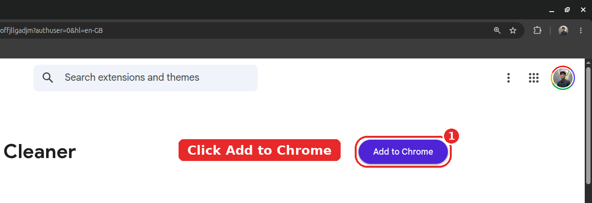
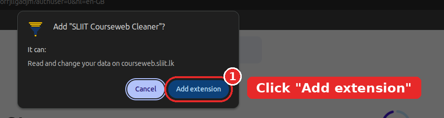
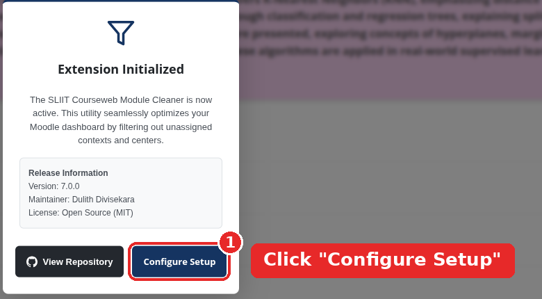
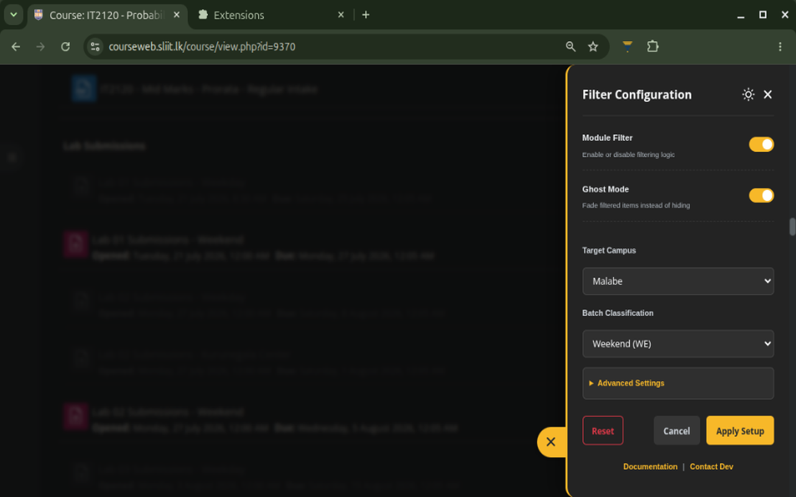
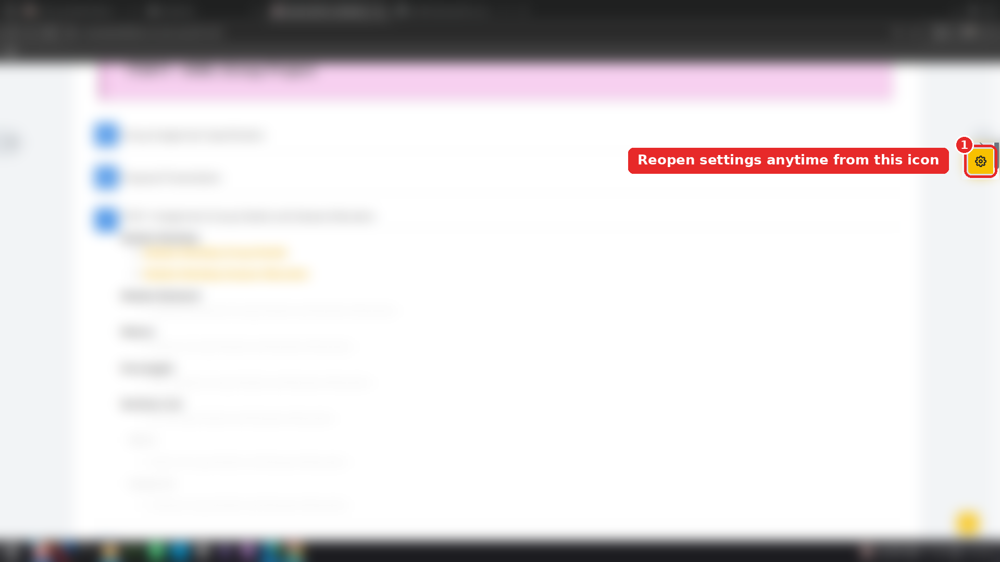
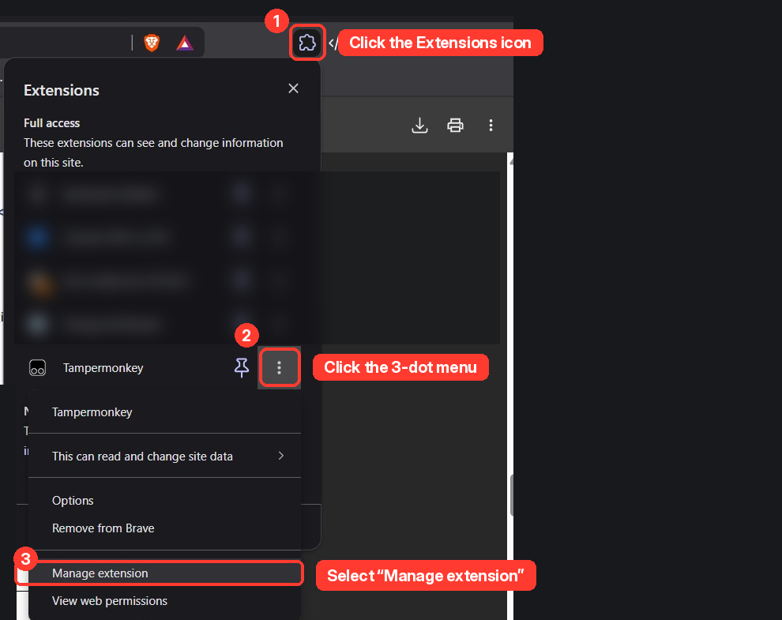
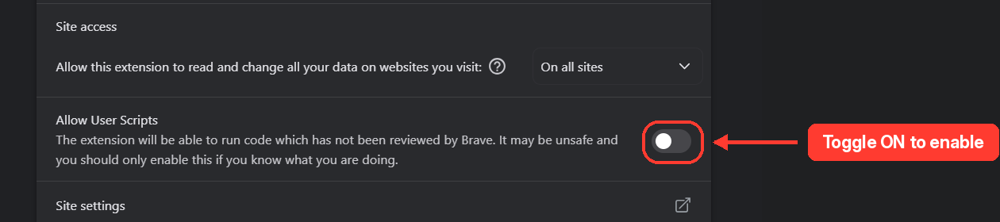
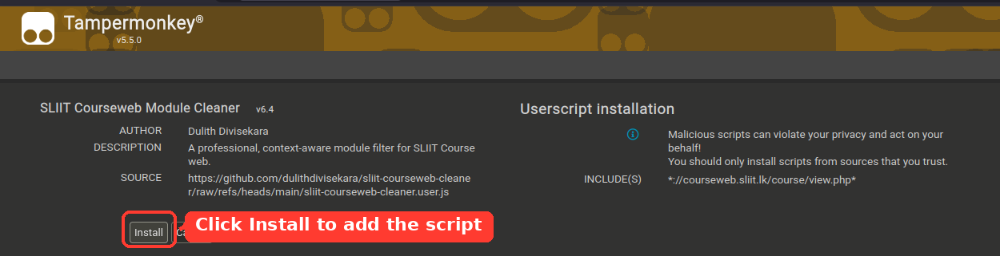

Complete installation, onboarding, and deployment instructions for **SLIIT Courseweb Module Cleaner** across Chromium browsers, Mozilla Firefox, userscript managers, and local developer environments.

---

## Browser & Runtime Compatibility Matrix

| Browser / Platform | Distribution Target | Minimum Version | Auto-Update Mechanism | Direct Installation Link |
| :--- | :--- | :--- | :--- | :--- |
| **Google Chrome** | Chromium MV3 Extension | Chrome 109+ | Chrome Web Store Sync | [Chrome Web Store](https://chromewebstore.google.com/detail/sliit-courseweb-cleaner/lnoadlfhebmkhmbfmehdgoffjllgadjm) |
| **Microsoft Edge** | Chromium MV3 Extension | Edge 109+ | Edge Add-ons Sync | [Microsoft Edge Add-ons](https://microsoftedge.microsoft.com/addons/detail/sliit-courseweb-cleaner/gmlodfhgiopjgamoijjffcmgfenkkkhe) |
| **Brave / Opera / Vivaldi / Arc** | Chromium MV3 Extension | Chromium 109+ | Chrome Web Store Sync | [Chrome Web Store](https://chromewebstore.google.com/detail/sliit-courseweb-cleaner/lnoadlfhebmkhmbfmehdgoffjllgadjm) |
| **Mozilla Firefox** | Gecko WebExtension | Firefox 109+ | Mozilla AMO Sync | [Firefox Add-ons (AMO)](https://addons.mozilla.org/en-US/firefox/addon/sliit-courseweb-cleaner/) |
| **Waterfox / LibreWolf / Floorp** | Gecko WebExtension | Gecko 109+ | Mozilla AMO Sync | [Firefox Add-ons (AMO)](https://addons.mozilla.org/en-US/firefox/addon/sliit-courseweb-cleaner/) |
| **Safari / Any Browser** | Standalone Userscript | Tampermonkey / Violentmonkey | GitHub `@updateURL` | [Install `.user.js`](https://github.com/dulithdivisekara/sliit-courseweb-cleaner/raw/refs/heads/main/dist/sliit-courseweb-cleaner.user.js) |

---

## Method 1: Official Web Store Installation (Recommended)

Installing from an official browser store provides automatic version upgrades and background 24-hour `rules.json` synchronization.

### 1. Open Your Browser Store Listing

Click the store badge corresponding to your browser:

<p align="center">
  <a href="https://chromewebstore.google.com/detail/sliit-courseweb-cleaner/lnoadlfhebmkhmbfmehdgoffjllgadjm" target="_blank" rel="noopener noreferrer">
    
  </a>
  &nbsp;&nbsp;&nbsp;
  <a href="https://microsoftedge.microsoft.com/addons/detail/sliit-courseweb-cleaner/gmlodfhgiopjgamoijjffcmgfenkkkhe" target="_blank" rel="noopener noreferrer">
    
  </a>
  &nbsp;&nbsp;&nbsp;
  <a href="https://addons.mozilla.org/en-US/firefox/addon/sliit-courseweb-cleaner/" target="_blank" rel="noopener noreferrer">
    
  </a>
</p>

### 2. Add Extension to Browser

Click **Add to Chrome**, **Get**, or **Add to Firefox** on the store page:

<p align="center">
  
</p>

### 3. Confirm Host Permissions

When prompted by the browser permission dialog, click **Add extension**.

> [!NOTE]
> The extension requests access strictly to `courseweb.sliit.lk` (to filter course DOM elements and inject dark theme styles) and `raw.githubusercontent.com` (to fetch read-only community filter rules). No personal data or browsing history is ever accessed.

<p align="center">
  
</p>

---

## First-Run Onboarding Workflow

To prevent accidental hiding of coursework before your profile is configured, the extension enforces a **Double-Lock Defense** architecture. No activities are hidden until you explicitly confirm your campus and batch settings.

```mermaid
sequenceDiagram
    autonumber
    actor Student
    participantCW as SLIIT Courseweb DOM
    participant Ext as Courseweb Cleaner Content Script
    participant Store as Storage & Local Cache

    Student->>participantCW: Navigate to courseweb.sliit.lk/course/view.php
    Ext->>Store: Read isConfigured flag
    Store-->>Ext: isConfigured = false (First Visit)
    Note over Ext,participantCW: Double-Lock Active: Zero DOM items hidden
    Ext->>participantCW: Render First-Time Welcome Prompt
    Student->>Ext: Click "Configure Setup"
    Ext->>participantCW: Slide out Side-Panel Configuration Drawer
    Student->>Ext: Select Campus, Batch & Group ID -> Click "Apply Setup"
    Ext->>Store: Persist profile + set isConfigured = true
    Ext->>participantCW: Execute cleanCoursePage() instantaneously (0 reload)
```

### Step 1: Launch Setup on Courseweb

Navigate to any course module on [courseweb.sliit.lk](https://courseweb.sliit.lk/). On your initial visit, the welcome dialog appears automatically. Click **Configure Setup**:

<p align="center">
  
</p>

### Step 2: Select Campus, Batch & Display Preferences

Inside the slide-out configuration drawer, select your **Target Campus**, **Batch Classification**, and optional **Group / Batch ID**, then click **Apply Setup**:

<p align="center">
  
</p>

### Step 3: Access Quick Controls Anytime

Once configured, a floating gold settings trigger is anchored at the bottom-right of every Courseweb page (directly above Moodle's native back-to-top button), accompanied by a badge showing the exact count of filtered items on the current page. You can also click the extension icon in your browser toolbar to open the quick popup controller:

<p align="center">
  
</p>

---

## Method 2: Userscript Installation (Tampermonkey / Violentmonkey)

If you prefer managing scripts via a userscript manager or use a browser without WebExtension store access:

### 1. Install a Userscript Manager

Install [Tampermonkey](https://www.tampermonkey.net/) or [Violentmonkey](https://violentmonkey.github.io/) for your browser.

### 2. Enable User Scripts Permission (Chromium MV3 Required)

In Chrome 120+ and Microsoft Edge, Manifest V3 requires enabling script execution for Tampermonkey:

1. Right-click the Tampermonkey icon in your toolbar and select **Manage extension**:
   <p align="center">
     
   </p>
2. Scroll down and toggle **Allow User Scripts** to the **On** position:
   <p align="center">
     
   </p>

### 3. Install the Compiled Userscript Bundle

Open the direct raw distribution URL:

- **[Install `sliit-courseweb-cleaner.user.js`](https://github.com/dulithdivisekara/sliit-courseweb-cleaner/raw/refs/heads/main/dist/sliit-courseweb-cleaner.user.js)**

Tampermonkey will intercept the `.user.js` file and display the installation screen. Click **Install**:

<p align="center">
  
</p>

---

## Method 3: Manual Developer Installation from Source

To test local modifications or run an unpacked build directly from the source repository:

### Prerequisites

- **Node.js** `18.0.0+` (for syntax validation and testing)
- **Bash** and `zip` (for executing `build.sh`)

### Build & Load Steps

1. Clone the repository and compile all distribution targets:
   ```bash
   git clone https://github.com/dulithdivisekara/sliit-courseweb-cleaner.git
   cd sliit-courseweb-cleaner
   chmod +x build.sh
   ./build.sh
   npm test
   ```

2. Load the unpacked extension into your browser:
   - **Chrome / Edge / Brave**:
     1. Navigate to `chrome://extensions` (or `edge://extensions`).
     2. Enable **Developer mode** in the top-right corner.
     3. Click **Load unpacked** and select the `/path/to/sliit-courseweb-cleaner/extension` directory.
   - **Mozilla Firefox**:
     1. Navigate to `about:debugging#/runtime/this-firefox`.
     2. Click **Load Temporary Add-on...**.
     3. Select `/path/to/sliit-courseweb-cleaner/extension/manifest.firefox.json`.

---

## Next Steps

- Learn how to configure Campus, Batch, and Faculty Sub-Group identifiers in **[User Guide and Configuration](User-Guide-and-Configuration)**.
- Explore how the 6-stage filtering pipeline evaluates Moodle activities in **[Heuristic Filtering Engine](Heuristic-Filtering-Engine)**.
