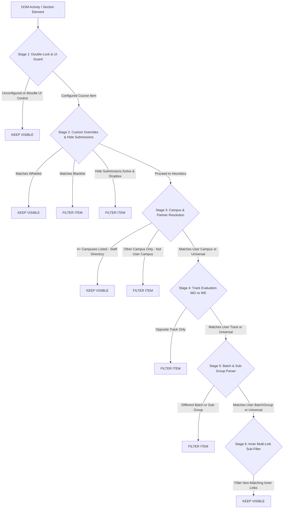
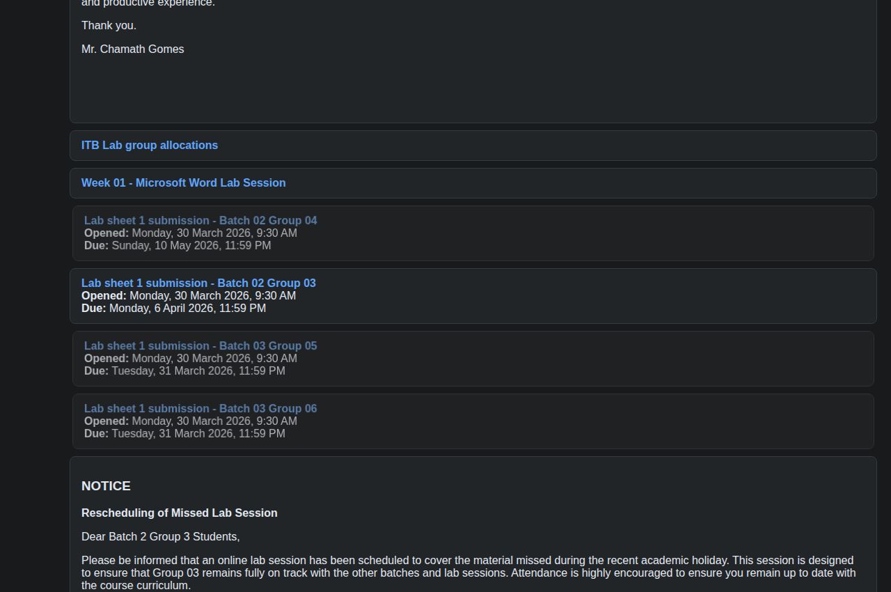
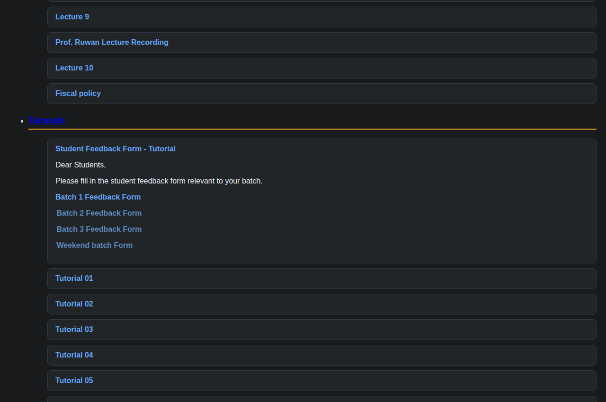

Deep technical specification of the 6-stage deterministic DOM evaluation pipeline implemented in [`src/shared-core.js`](https://github.com/dulithdivisekara/sliit-courseweb-cleaner/blob/main/src/shared-core.js), including campus alias canonicalization, multi-batch range parsing, Business School sub-group resolution, and section-scoped context propagation.

---

## Evaluation Pipeline Architecture

Every activity container (`li.activity`), inline label (`modtype_label`), and multi-link container on a SLIIT Courseweb page passes through a deterministic 6-stage decision pipeline:

---

## Stage 1: Double-Lock Defense & Moodle UI Safeguards

### 1. Double-Lock Onboarding Guard

If `config.isConfigured` is `false` or `config.filterEnabled` is `false`, `cleanCoursePage()` immediately restores all previously modified elements and exits. This guarantees zero false-positive content removal before a student completes initial setup.

### 2. Moodle Native UI Exclusion (`isMoodleUIElement`)

To ensure Moodle navigation controls, group switchers, and form inputs are never hidden even if their option labels contain campus names, `isMoodleUIElement(el)` explicitly protects:
- Form controls (`select`, `option`, `input`, `button`, `form`)
- Group and cohort selectors (`.groupselector`, `.singleselect`, `.urlselect`)
- Navigation bars and drawers (`nav`, `.navbar`, `.breadcrumb`, `[role="navigation"]`, `#nav-drawer`, `.block_navigation`, `.block_settings`)

### 3. Screen-Reader Prefix Sanitization (`getCleanActivityText`)

Moodle 4.5 injects hidden screen-reader action labels (such as `"Select activity Notice"` or `"Select activity Lab 01"`) inside `.sr-only` and `.accesshide` spans. Before evaluating any activity node, `getCleanActivityText(el)` clones the node, strips `.sr-only`, `.accesshide`, `[ data-region="completion-info" ]`, and `.activity-information`, and normalizes whitespace.

---

## Stage 2: Universal Notice & Core Material Protection

### 1. Protected Academic Resources (`isCoreMaterial`)

Within mixed course sections, foundational academic resources must remain accessible regardless of sticky section headers:
- **Lecture Materials**: `Lecture Slide`, `Lecture Note`, `Lesson`, `Week \d+ Lecture`
- **Tutorials & Labs**: `Tutorial \d+`, `Tute \d+`, `Lab Sheet`, `Case Study`, `Worksheet`
- **Module Governance**: `Module Outline`, `Delivery Schedule`, `Course Outline`, `Marking Rubric`, `Assessment Criteria`, `Specification`, `Past Paper`, `Reference Book`

### 2. Universal Notice Protector

Announcements containing high-priority academic keywords (`final exam`, `mid exam`, `examination`, `rescheduled`, `important notice`, `all students`, `academic integrity`) are protected unless they explicitly target a single non-matching campus or batch cohort.

---

## Stage 3: Canonical Campus Alias & Tangential Mention Resolution

Lecturers across faculties use varying abbreviations and occasional misspellings when naming regional center activities. `getMentionedCampuses(text)` normalizes all campus references into canonical identifiers:

| Canonical ID | Regex Pattern (`CAMPUS_PATTERNS`) | Handled Edge Cases |
| :--- | :--- | :--- |
| `Malabe` | `\b(?:malabe\|mlb)\b` | Matches `Malabe Campus`, `MLB Weekday` |
| `Metro` | `\b(?:metro(?:politan)?\|colombo(?:\s+cent(?:er\|re))?)\b` | Resolves `Colombo Center` and `Metro` to the same cohort |
| `Kandy` | `\b(?:kandy\|kdy)\b` | Matches `Kandy Center`, `Kandy Centre`, `Kandy Uni` |
| `Kurunegala` | `\b(?:kurunegala\|kurunegale\|kurunagala\|krn)\b` | Handles common lecturer typos `Kurunegale` and `Kurunagala` |
| `Matara` | `\b(?:matara\|mathara\|mtr)\b` | Handles phonetic spelling `Mathara` |
| `Jaffna` | `\b(?:jaffna\|northern(?:\s*uni(?:versity)?)?\|nothern(?:\s*uni(?:versity)?)?\|jfn\|nu(?=\s*(?:uni\|cent\|group\|batch\|student\|intake\|dataset\|lecture\|lab\|tute\|online\|exam\|quiz\|mid\|assignment\|session\|-\|\d\|$)))\b` | Matches `Jaffna`, `Northern Uni`, typo `Nothern`, and `NU` prefix tokens (`NU Dataset`, `NU Group 1`) without colliding with words like `"number"` |
| `Curtin` | `\b(?:curtin)\b` | Isolates Curtin international degree streams |
| `Deakin` | `\b(?:deakin)\b` | Isolates Deakin international degree streams |

### Special Campus Exemptions

1. **Tangential Remarks Stripping**:
   In modules such as `BM1044` (`module-476108`), a universal Mid-Term Quiz announcement included the parenthetical remark `"(new date as per the request of Matara Centre)"`. Before running `getMentionedCampuses()`, the engine strips tangential remarks matching `\b(?:as\s+per\s+the\s+)?request\s+of\s+[a-z]+\s*(?:cent(?:er|re)|campus|uni(?:versity)?)?\b` so universal notices remain visible to all campuses.
2. **Multi-Campus Staff Directories (`mentionedCampuses.length >= 4`)**:
   Course overview blocks that list module coordinators across 4 or more campuses (`Malabe / Metro / Matara / Kandy / Kurunegala / Northern Uni` in `BM1042` and `BM1045`) are recognized as universal directories and never hidden.

---

## Stage 4: Multi-Batch, Range & Faculty Sub-Group Parser

### 1. Numbered Batch & Range Extraction (`extractBatchNumbers`)

The batch parser extracts discrete and ranged batch declarations while preventing false matches against dates, URLs, and meeting IDs:

| Pattern Type | Input Text Example | Extracted Batches | Technical Safeguard |
| :--- | :--- | :--- | :--- |
| **Single Batch** | `Batch 02`, `Bacth 01` | `[2]`, `[1]` | Includes lecturer typo `bacth` (`BM1012`) |
| **Conjunction List** | `Batch 1, 2 and 3`, `Batches 01 & 03` | `[1, 2, 3]`, `[1, 3]` | Parses comma, `&`, `+`, `/`, and `and` chains |
| **Inclusive Range** | `Batch 01 - 04`, `Batches 1 to 3` | `[1, 2, 3, 4]`, `[1, 2, 3]` | Expands ranges up to `end - start <= 10` |
| **Spaced Ordinal Date Guard** | `Meeting Link for Batch 02 - 17 th April 2026` | `[2]` (ignores `17`) | Negative lookahead `\d{1,2}\b(?!\s*(?:st\|nd\|rd\|th)\b)` prevents `"02 - 17 th"` from being parsed as batches `2..17` (`BM1014`) |
| **URL & Meeting ID Sanitization** | `Meeting ID: 432 891 204 11` | `[]` | Strips URLs, 8-digit dates, and Teams IDs prior to regex evaluation |

### 2. Business Faculty Sub-Group Resolution (`extractBatchSubGroups`)

In SLIIT Business School modules (such as `BM1015` IT for Business), lab dropboxes and reschedule notices use compound batch + group identifiers (`"Lab sheet 1 submission - Batch 02 Group 03"`, `"Batch 1 - Group 1 and Batch 1 - Group 2"`).

- `extractBatchSubGroups(text)` extracts `[{ batch: 2, group: 3 }]` pairs.
- If a student enters a plain batch number (`2`), they see all `Batch 2` items (`Group 1`, `Group 2`, `Group 3`, `Group 4`).
- If a student enters a specific sub-group (`Batch 2 Group 3`, `B2 G3`, or `2.3`), `shouldBlock()` retains **only** `Batch 02 Group 03` while filtering out `Batch 02 Group 04` and `Batch 03 Group 05`:

  

### 3. Weekday Day-of-Week Cohort Detection (`hasWeekdayIndicator`)

In addition to explicit `Weekday`, `WD`, and `Regular Batch` tags, certain modules (such as `BM1041` Business Communication) label weekday streams by day of the week (`"Assignment 1_Malabe (Monday Batch_ Miss Colini)"`, `"(Tuesday Batch_ Miss Oshani)"`). `hasWeekdayIndicator(text)` matches `\b(?:monday|tuesday|wednesday|thursday|friday)[\s._-]+batch(?:[\s._-]|$)` so these activities are properly classified under `Weekday (WD)`.

---

## Stage 5: Section-Scoped Sticky Context & Sub-Item Filtering

### 1. Section-Scoped Context Isolation

Courseweb lecturers frequently organize cohorts in two ways:
1. **Dedicated Cohort Sections**: An entire Moodle `.section` is titled `"Kandy Center"` or `"Matara Center"`, and activities inside it are simply named `"Lecture Link"` or `"Group Details"`.
2. **Inline Sub-Header Dividers**: Within a single topic section, a `modtype_label` banner says `"Online Lecture Links - Northern Uni"` followed by generic `"Week 01 Lecture"` links.

The engine tracks `stickyBlock` state strictly within the boundary of each `li.section` container and resets it when entering a new section or encountering a universal divider (`Tutorials`, `Labs`, `Lectures`), ensuring context never bleeds across topics.

### 2. Inner Multi-Link Container Filtering

When a single Moodle activity block contains multiple cohort-specific links inside `.no-overflow` (defined as `noOverflow.querySelectorAll('a[href]').length > 1`), such as `BM1042` `"Student Feedback Form - Tutorial"` containing separate links for `Batch 1`, `Batch 2`, `Batch 3`, and `Weekend batch`, the engine evaluates each inner `
` or `<li>` link element individually:

  

> [!NOTE]
> Prose announcements that do not contain multiple distinct `a[href]` links (for example, a schedule notice mentioning both Batch 1 and Batch 2 discussion dates in plain text) are exempted from inner paragraph hiding so notice text is never partially blanked out.
