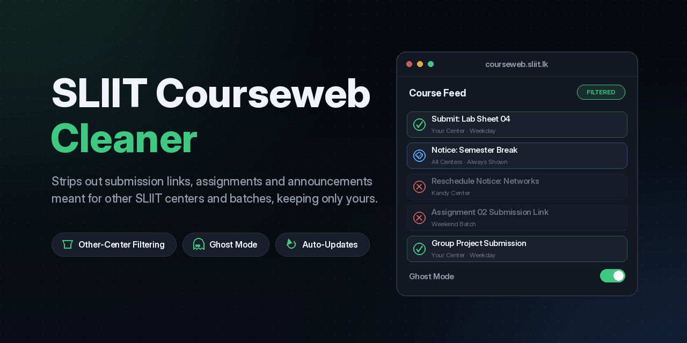
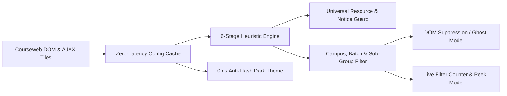

  

  
  
  
  
  

**SLIIT Courseweb Module Cleaner** is a context-aware browser extension and userscript engineered to eliminate visual noise across the SLIIT Moodle learning management system (`courseweb.sliit.lk`). It combines a deterministic 6-stage campus, batch, and faculty sub-group filtering engine with a zero-flash dark theme preloader, real-time filter inspection controls, and automated background rule synchronization.

  

---

## Official Store Distribution

Install verified, signed packages directly from your browser's official extension repository:

  
  &nbsp;&nbsp;&nbsp;
  
  &nbsp;&nbsp;&nbsp;
  

---

## Documentation Navigator

| Wiki Page | Technical Scope | Target Audience |
| :--- | :--- | :--- |
| **[[Getting Started|Getting-Started]]** | Browser compatibility matrix, 1-click store installation, userscript deployment, and first-run onboarding workflow. | All students and new users |
| **[[User Guide and Configuration|User-Guide-and-Configuration]]** | Complete guide to the Slide-In Side Panel, Toolbar Popup, Campus/Batch/Group formats, Ghost Mode, Hide Submissions, and Peek Hidden. | Students configuring profiles |
| **[[Heuristic Filtering Engine|Heuristic-Filtering-Engine]]** | Deep architectural breakdown of the 6-stage DOM evaluation pipeline, regex parsers, campus alias normalization, and faculty group rules. | Contributors and power users |
| **[[Architecture and Dark Theme|Architecture-and-Dark-Theme]]** | Multi-target build pipeline, zero-flash `0ms` Dark Reader preloader, Moodle Lambda2/Boost skeleton suppression, and storage sync. | Extension developers |
| **[[Community Rules and Development|Community-Rules-and-Development]]** | Remote `rules.json` schema, 24-hour background sync lifecycle, local build compilation (`build.sh`), and automated test suites. | Open-source maintainers |
| **[[Troubleshooting and FAQ|Troubleshooting-and-FAQ]]** | Diagnostic decision tree, solutions for missing regional activities, userscript permissions, Service Worker inspection, and FAQs. | Users resolving edge cases |

---

## System Overview

SLIIT Courseweb course pages aggregate hundreds of activity blocks, submission dropboxes, Teams/Zoom meeting links, and notices across 8 campus centers and multiple academic schedules into a single scrolling feed. SLIIT Courseweb Module Cleaner intercepts and evaluates the DOM in real time:

### Key Technical Capabilities

- **Multi-Campus & Partner Isolation**: Native support for **Malabe**, **Metro (Colombo)**, **Kandy**, **Kurunegala**, **Matara**, **Jaffna / Northern Uni**, **Curtin University**, and **Deakin University**, complete with automatic typo and alias resolution (`Mathara`, `Kurunegale`, `Northern Uni`, `NU`, `Colombo`).
- **Cross-Faculty Cohort Precision**: Engineered and verified across 34 live Courseweb modules spanning the **Faculty of Computing** (`IT`, `SE`, `CS`, `DS`, `CSNE`, `ISE`, `IM`, `CY`), **SLIIT Business School** (`BM1011`-`BM1046` compound `Batch 02 Group 04` formats), and **Faculty of Engineering** (`EN`).
- **Universal Notice & Core Material Protection**: Automatically preserves exam announcements, reschedule alerts, module outlines, lecture slides, tutorial sheets, and marking rubrics while stripping Moodle 4.5 screen-reader prefixes (`Select activity Notice`) to prevent false-positive leaks.
- **Zero-Flash Dark Theme Engine**: Synchronously caches theme state in `localStorage` at `document_start` (`0ms`), suppressing Moodle skeleton placeholders and white icon flashes before the first browser paint.
- **Interactive Filter Auditing**: Provides a live filtered-item counter badge, a 1-click **Peek Hidden** inspection mode (outlining hidden activities in dashed gold), **Ghost Mode** (`opacity: 0.25`), and a **Hide Submissions** toggle.

---

## Supported Faculties & Academic Programs

| Faculty / Program | Supported Course Formats | Supported Group & Batch Naming Conventions |
| :--- | :--- | :--- |
| **Faculty of Computing** | `format_topics`, `format_tiles`, `format_weeks` | `Batch 1`, `01.02`, `2.2`, `Y2.S1.WD.IT.01.02`, `SE`, `CS`, `DS`, `CY` |
| **SLIIT Business School** | `format_topics`, `format_tiles` | `Batch 01`, `Batch 02 Group 04`, `B2 G3`, `Monday Batch_`, `Weekend Batch` |
| **Regional Centers (Kandy, Matara, Kurunegala, Northern Uni, Metro)** | All Moodle 4.x layouts | Center-tagged sections, weekday-only center cohorts, `NU Group 1`, `Kandy Center` |
| **International Partner Programs** | `format_topics`, `format_tiles` | `Curtin`, `Deakin` program streams and isolated partner resources |

---

## Related Ecosystem Projects

- **[Main Source Repository](https://github.com/dulithdivisekara/sliit-courseweb-cleaner)**: Canonical codebase, issue tracker, and release artifacts.
- **[Official Web Portal](https://sliit-courseweb-cleaner-web.pages.dev/)**: Landing page and interactive installation guide.
- **[SLIIT Courseweb MCP Server](https://github.com/kesaruhasun/mcp-sliit-courseweb)**: Model Context Protocol server enabling AI coding assistants (Google Antigravity, Claude Code, Cursor) to query Courseweb modules, deadlines, and lecture materials directly.
