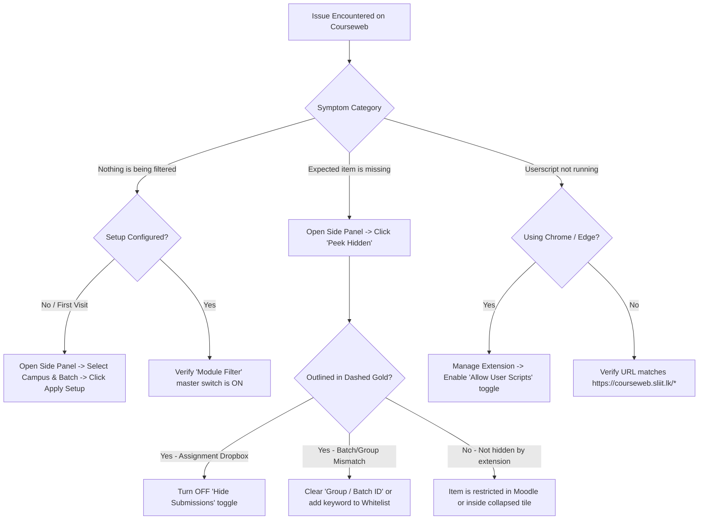

Diagnostic flowcharts, step-by-step troubleshooting procedures, and answers to frequently asked questions for **SLIIT Courseweb Module Cleaner**.

---

## Interactive Diagnostic Flowchart

Use this decision tree to quickly isolate and resolve filtering, display, or userscript issues:



---

## Common Issues & Resolutions

### 1. No items are being filtered after installing the extension

#### Symptom
After installing the extension from the Chrome Web Store, Edge Add-ons, or Firefox Add-ons, Courseweb pages still display items from all campuses and batches.

#### Cause
The **Double-Lock Defense** architecture intentionally disables DOM filtering until you explicitly save your campus and batch configuration (`isConfigured = true`). Additionally, the **Module Filter** master toggle may be turned off.

#### Resolution
1. Click the floating gold gear button at the bottom-right of any Courseweb page (or click the extension icon in your browser toolbar).
2. Select your **Target Campus** and **Batch Classification** (`Weekday` or `Weekend`).
3. Ensure **Module Filter** is toggled **On**.
4. Click **Apply Setup**.

---

### 2. How do I check if an important link or submission dropbox was hidden?

#### Symptom
A lecturer mentioned an assignment dropbox, feedback link, or group notice in class, and you want to verify whether it was filtered out on the page.

#### Cause
The activity may have been tagged with a different batch number, or **Hide Submissions** mode may be active.

#### Resolution
1. Open the Slide-In Side Panel Drawer using the bottom-right gold button.
2. Look at the **Live Filter Status Banner** at the top of the panel (e.g. `27 items filtered on page`) and click **Peek Hidden**.
3. Every item filtered by the extension will immediately appear in-place with a **dashed gold outline (`#f7b924`)**.
4. If the item you need is an assignment dropbox (`modtype_assign`), toggle **Hide Submissions** to **Off**.
5. If the item has a non-standard label you always want to keep, add a keyword from its title to **Advanced Settings -> Whitelist (Always Show)** and click **Apply Setup**.

---

### 3. Regional center (Kandy, Matara, Kurunegala, Northern Uni) activities are missing when Group ID is entered

#### Symptom
When a regional center student enters a number or code into **Group / Batch ID**, some universal or center-wide items disappear.

#### Cause
Regional centers typically operate a single weekday cohort or use group numbers (`Group 1`, `Group 2`) only for specific lab sessions whileMalabe uses `Batch 1`, `Batch 2`, `Batch 3` across lectures.

#### Resolution
- Upgraded in **v7.3.0**: The heuristic engine now automatically protects activities explicitly tagged with your regional center name or located inside your center's dedicated Moodle section.
- If your regional center does not subdivide into numbered batches (`Batch 1`, `Batch 2`), leave the **Group / Batch ID** field **empty** so all materials for your center are retained.

---

### 4. Business Faculty (`BM1011`-`BM1046`) sub-group lab submissions not matching

#### Symptom
In Business School modules such as `BM1015` (IT for Business), lab submission links are titled `"Lab sheet 1 submission - Batch 02 Group 03"` and `"Batch 02 Group 04"`.

#### Resolution
In **v7.3.0**, the **Group / Batch ID** input natively supports Business School compound identifiers:
- Enter `2` to view all sub-groups within Batch 2 (`Group 01` through `Group 04`).
- Enter `Batch 2 Group 3`, `B2 G3`, or `2.3` to filter down strictly to **Batch 02 Group 03** while hiding other sub-groups.

---

### 5. Userscript does not execute in Chrome or Microsoft Edge

#### Symptom
You installed `sliit-courseweb-cleaner.user.js` in Tampermonkey, but neither Dark Mode nor the floating settings trigger appears on `courseweb.sliit.lk`.

#### Cause
Chromium Manifest V3 requires explicit user opt-in for extensions that execute dynamic user scripts.

#### Resolution
1. Open `chrome://extensions` (or `edge://extensions`).
2. Click **Details** on the **Tampermonkey** card.
3. Scroll down and enable the **Allow User Scripts** toggle.
4. Reload your `courseweb.sliit.lk` tab.

---

## Developer Diagnostics & Log Inspection

### Filtering Content Script Logs in DevTools

Open Browser Developer Tools (`F12` or `Ctrl+Shift+I`) on any Courseweb page, switch to the **Console** tab, and filter by:

```text
[Courseweb Cleaner]
```

### Inspecting Background Service Worker & Storage State

To inspect your active synchronized configuration or trigger a manual `rules.json` inspection in Chrome/Edge:

1. Navigate to `chrome://extensions` and enable **Developer mode**.
2. Locate **SLIIT Courseweb Module Cleaner** and click **Inspect views: service worker**.
3. Run the following commands in the Service Worker DevTools console:

```javascript
// 1. Inspect active student profile in chrome.storage.sync
chrome.storage.sync.get(null, (cfg) => console.table(cfg));

// 2. Inspect cached remote rules.json and last update timestamp
chrome.storage.local.get(['remoteRules', 'lastRulesUpdate'], (data) => {
  console.log('Last Rules Sync:', new Date(data.lastRulesUpdate).toLocaleString());
  console.log('Remote Rules Payload:', data.remoteRules);
});

// 3. Check next scheduled 24-hour alarm
chrome.alarms.get('fetchRulesAlarm', (alarm) => console.log(alarm));
```

---

## Frequently Asked Questions (FAQ)

### Privacy & Security

#### Does this extension read or transmit my SLIIT password, student ID, or grades?
No. All DOM filtering and Dark Theme styling execute **100% locally** inside your browser's client-side sandbox. Zero student data, session cookies (`MoodleSession`), registration numbers, or course contents are ever collected or transmitted to any external server.

#### Why does the extension request permission for `raw.githubusercontent.com`?
The background service worker periodically performs a read-only `GET` request to `https://raw.githubusercontent.com/dulithdivisekara/sliit-courseweb-cleaner/main/rules.json` every 24 hours so newly discovered campus aliases and notice protection keywords are delivered automatically without waiting for browser store review queues.

### Usage & Performance

#### Does hiding items with the extension affect Moodle activity completion tracking?
No. Filtering modifies only client-side CSS presentation (`display: none` or `opacity: 0.25` in Ghost Mode). Your Moodle enrollment, gradebook records, and completion checkmarks on the server remain completely untouched.

#### Will my settings sync across my laptop and desktop?
Yes. When signed into Google Chrome, Microsoft Edge, or Mozilla Firefox, your profile configuration is stored in `chrome.storage.sync` / `browser.storage.sync` and automatically synchronizes across your signed-in desktop devices.
