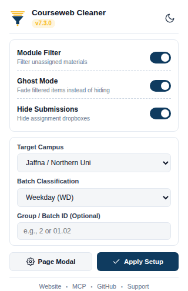
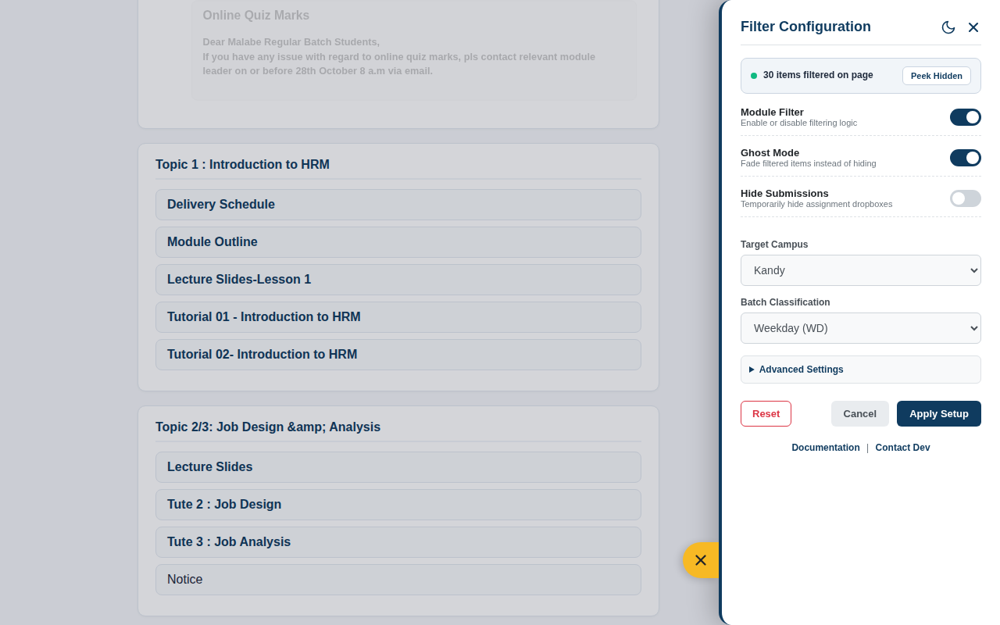
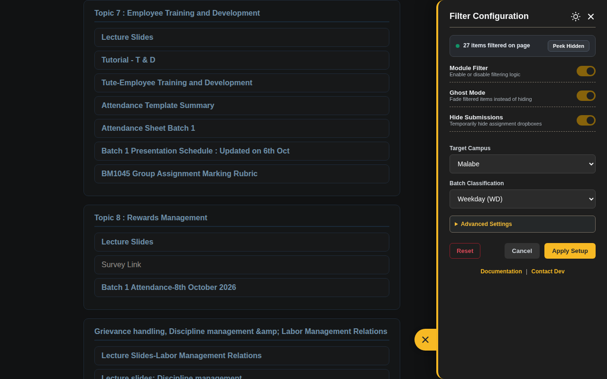
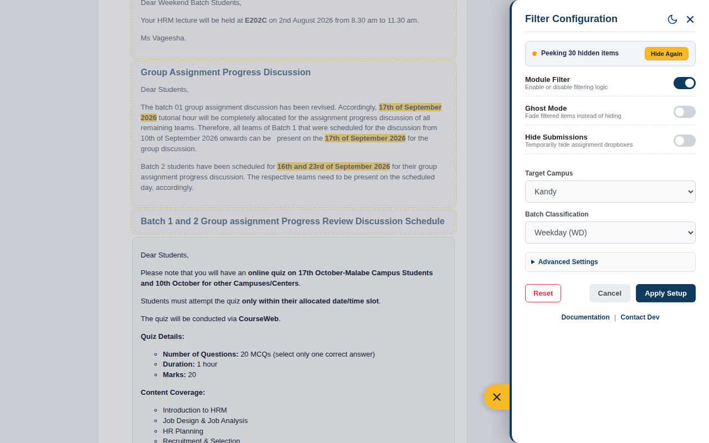

Comprehensive guide to all user interface controls, academic profile parameters, display modes, and inspection tools in **SLIIT Courseweb Module Cleaner**.

---

## Control Surfaces Overview

The extension provides two synchronized configuration interfaces. Changes made in either interface take effect immediately across all open Courseweb tabs without requiring a page reload.

| Interface | Access Method | Primary Use Case | Supported Controls |
| :--- | :--- | :--- | :--- |
| **Slide-In Side Panel Drawer** | Click the floating gold gear button (`bottom: 60px; right: 0`) on any Courseweb page, or click **Page Modal** inside the toolbar popup. | Full profile setup, live filter counter inspection, **Peek Hidden** mode, and custom Whitelist/Blacklist keyword rules. | All standard + advanced settings, Peek Hidden button, Reset button |
| **Toolbar Action Popup** | Click the **Courseweb Cleaner** icon in the browser extension toolbar. | Rapid 1-click toggling of Dark Mode, Module Filter, Ghost Mode, Hide Submissions, or switching Campus/Batch profiles. | Core toggles, Campus, Batch, Group ID, Dark Theme toggle |

  

---

## Academic Profile Configuration

### 1. Target Campus Selection

Select the physical campus center or international partner program where you are enrolled. The heuristic engine resolves both standard names and common lecturer spelling variations automatically:

| Campus Profile Option | Canonical Value | Matched Courseweb Labels & Spelling Variants |
| :--- | :--- | :--- |
| **Malabe** | `Malabe` | `Malabe`, `MLB`, `Malabe Campus`, `Main Campus` |
| **Metro** | `Metro` | `Metro`, `Metro Campus`, `Metropolitan`, `Colombo`, `Colombo Center` |
| **Kandy** | `Kandy` | `Kandy`, `Kandy Center`, `Kandy Centre`, `Kandy Uni`, `KDY` |
| **Kurunegala** | `Kurunegala` | `Kurunegala`, `Kurunegale`, `Kurunagala`, `Kurunegala Center` |
| **Matara** | `Matara` | `Matara`, `Mathara`, `Matara Center`, `Matara Centre` |
| **Jaffna / Northern Uni** | `Jaffna` | `Jaffna`, `Northern Uni`, `Northern`, `Nothern`, `NU`, `NU Group`, `NU Dataset`, `Jaffna Center` |
| **Curtin** | `Curtin` | `Curtin`, `Curtin University`, `Curtin Colombo` |
| **Deakin** | `Deakin` | `Deakin`, `Deakin University` |

> [!TIP]
> If an activity or announcement is shared across multiple cohorts (for example, `"ITB Batch 01 and Matara Batch"` or `"Weekend Batch / Center Repeats & Northern Uni"`), the engine automatically keeps it visible for every mentioned cohort.

---

### 2. Batch Classification (`Weekday` vs `Weekend`)

Select your scheduled lecture track:

- **Weekday (`WD`)**: Retains universal materials and Weekday-designated activities (`Weekday`, `WD`, `Regular Batch`, or day-of-week weekday batches such as `Monday Batch_` and `Tuesday Batch_`) while suppressing `Weekend` / `WE` items.
- **Weekend (`WE`)**: Retains universal materials and Weekend-designated activities (`Weekend`, `WE`, `Weekend Batch`) while suppressing `Weekday` / `WD` items.

> [!IMPORTANT]
> **Regional Center Weekday Protection**: Many regional centers (such as Kandy, Matara, Kurunegala, and Northern Uni) conduct only a single weekday cohort and do not label their items with `Weekday`, or they share numbered batch labels (`Group 1`, `Group 2`) inside a center-specific section. When a regional center is selected with `Weekday (WD)`, activities explicitly tagged with your regional center name or residing inside your center's dedicated section are automatically protected from false-positive batch suppression.

---

### 3. Group & Batch ID Formats (Optional)

The **Group / Batch ID** input field supports flexible identifiers across all SLIIT faculties (Computing, Business School, Engineering, and Humanities & Sciences). Leave this field blank if you want to see materials for all numbered batches within your selected campus and track.

| Input Format Style | Example User Inputs | Matched Courseweb Activity Titles | Primary Faculty Usage |
| :--- | :--- | :--- | :--- |
| **Plain Batch Number** | `1`, `2`, `03`, `13` | `Batch 1`, `Batch 02`, `Weekday Batch 13`, `Batch 1 and 2`, `Batch 01 - 03` | All Faculties (Computing, Business, Engineering) |
| **Decimal Sub-Group** | `01.02`, `1.2`, `2.3`, `13.1` | `Group 01.02`, `G1.2`, `Batch 2 Group 3`, plus parent `Batch 1` / `Batch 2` items | Faculty of Computing (`IT`, `SE`, `CS`, `DS`) & Business |
| **Business Compound Batch + Group** | `Batch 2 Group 3`, `B2 G3`, `Batch 01 Group 02` | `Lab sheet 1 submission - Batch 02 Group 03`, `Dear Batch 2 Group 3 Students`, plus parent `Batch 2` items | SLIIT Business School (`BM1015` IT for Business, etc.) |
| **Full Registration Group Code** | `Y2.S1.WD.IT.01.02`, `Y1.S2.WE.BM.02.01` | Extracts batch `1`, sub-group `2`, and matches both full group strings (`Y2.S1.WD.IT.01.02`) and parent batch items | All Faculties |

---

## Display & Inspection Modes

### 1. Module Filter (Master Switch)

Toggles the entire heuristic filtering engine on or off. When turned **Off**, all course modules immediately revert to their unmodified Moodle visibility state while keeping your Dark Theme preference active.

### 2. Ghost Mode (Fade Instead of Hide)

Instead of removing non-matching items from the layout (`display: none`), **Ghost Mode** renders filtered items at `25%` opacity (`opacity: 0.25`) with grayscale muting. Clicking or hovering over a ghosted item remains possible if you ever want to cross-check other cohorts' schedules.

  

### 3. Hide Submissions Mode

During revision weeks or when browsing a module exclusively for lecture slides and tutorials, dozens of past lab and assignment submission dropboxes can clutter each topic section.

Enabling **Hide Submissions**:
- Hides Moodle assignment submission containers (`.modtype_assign`, `.modtype_turnitintooltwo`) and links explicitly titled as submission dropboxes (`Submission Link`, `Upload Here`, `Drop Box`).
- **Strictly Preserves** assignment specification documents, question papers, dataset archives, and marking rubrics (`Assignment Specification`, `Marking Scheme`, `Rubric`, `Guideline`, `Template`).

  

### 4. Live Filter Status Banner & Peek Hidden Mode

At the top of the Slide-In Side Panel Drawer, the **Live Filter Status Banner** reports the exact count of items currently filtered on the page (for example, `30 items filtered on page`). This count is also mirrored as a pill badge on the floating bottom-right settings trigger.

Clicking the **Peek Hidden** button inside the banner activates **Peek Mode**:
- Temporarily reveals all hidden items in-place on the page.
- Highlights every revealed item with a distinct **dashed gold border (`#f7b924`)** and a subtle tinted background so you can visually audit exactly what was filtered out.
- Clicking **Hide Again** (or closing the drawer) immediately restores normal filtering.

  

---

## Advanced Settings & Custom Overrides

Expand the **Advanced Settings** accordion inside the Slide-In Side Panel Drawer to configure fine-grained keyword overrides:

| Setting | Format | Evaluation Priority | Example Usage |
| :--- | :--- | :--- | :--- |
| **Whitelist (Always Show)** | Comma-separated keywords (case-insensitive) | Evaluated **before** campus/batch heuristics. Any item containing a whitelist keyword is unconditionally kept visible. | `Prorata, Repeat, Mid Exam, Group 04` |
| **Blacklist (Always Hide)** | Comma-separated keywords (case-insensitive) | Evaluated immediately after Whitelist. Any item containing a blacklist keyword is unconditionally suppressed. | `Supplementary, Old Syllabus, 2025 Intake` |
| **Reset Button** | 1-click action with confirmation | Clears stored profile settings, resets custom keywords, and restores the extension to its unconfigured initial state. | Switching faculties or resetting test profiles |
